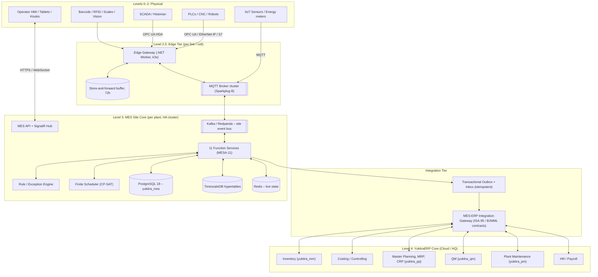
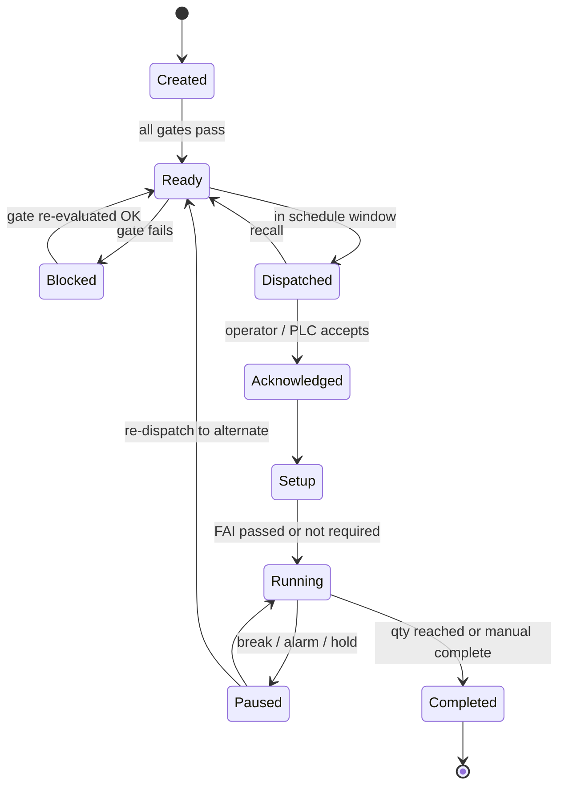
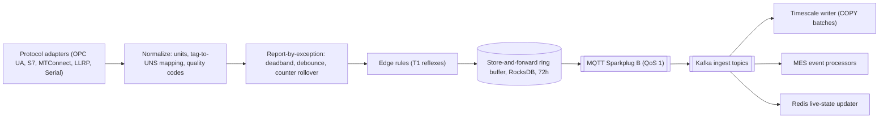
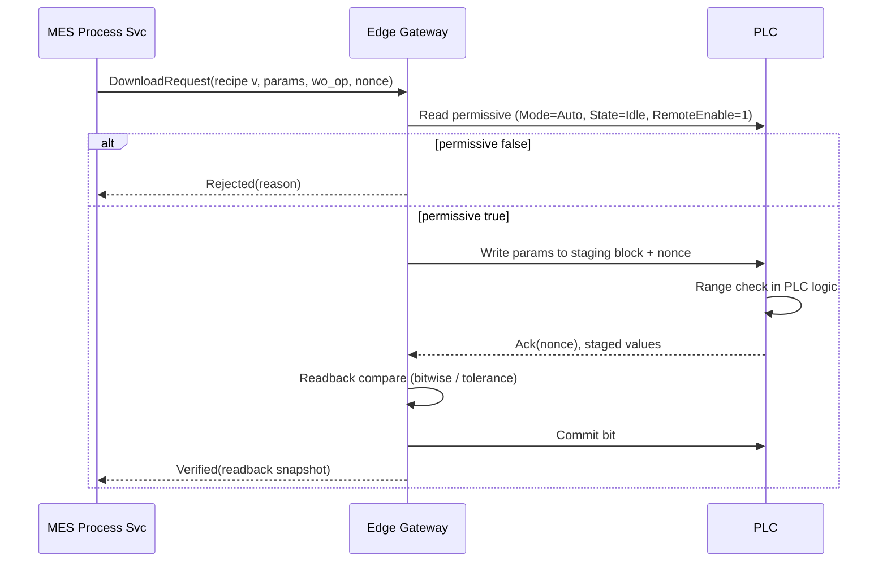
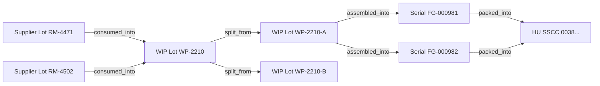
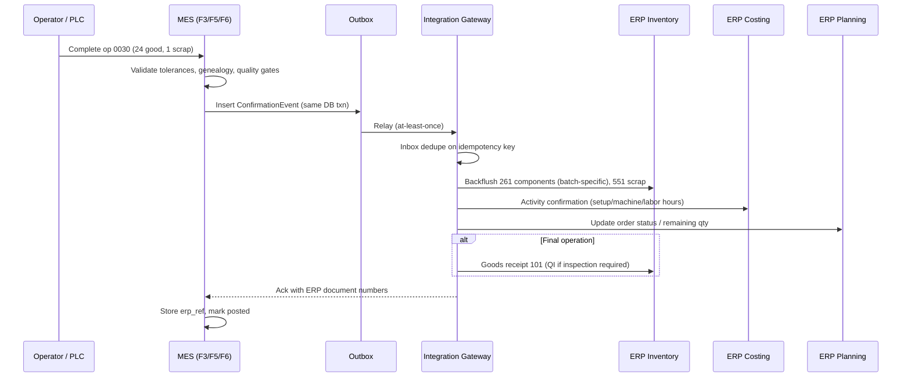
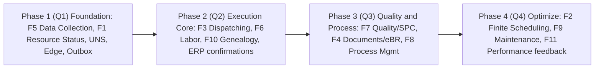

# YuktiraERP MES: MESA-11 Shop-Floor Execution Blueprint

**Version:** 1.0 (Design Baseline) · **Date:** November 2026 · **Status:** Architecture proposal
**Scope:** ISA-95 Level 3 (Manufacturing Operations Management), connecting YuktiraERP Level 4 (Inventory, Costing, Master Planning) with Level 0–2 (PLC, SCADA, sensors, operators)
**Target stack:** .NET 10 · PostgreSQL 18 (+ TimescaleDB) · Redis · Kafka/Redpanda · MQTT (Sparkplug B) · OPC UA · SignalR

---

## Part A: Reference Architecture

### A.1 Layered Topology



### A.2 Architectural Principles

| # | Principle | Rationale / Implementation |
|---|-----------|----------------------------|
| P1 | **MES is never in the control loop** | Hard real-time (< 10 ms) stays in PLCs. MES writes setpoints only through permissive handshakes (see F8). |
| P2 | **Site autonomy** | Each plant's MES core keeps running for **≥ 72 h without ERP**. Each edge gateway keeps running for **≥ 24 h without the MES core**. All up-sync goes through a durable outbox. |
| P3 | **Event-first, state-second** | Each shop-floor fact is an immutable event on the bus. Relational state is a projection of those events, which makes replay, audit and genealogy possible. |
| P4 | **Unified Namespace (UNS)** | One ISA-95 topic hierarchy for all real-time data: `yuktira/{tenant}/{site}/{area}/{line}/{cell}/{asset}/{class}/{metric}` |
| P5 | **Edge timestamps are authoritative** | All devices sync through PTP (IEEE 1588) or NTP stratum ≤ 2. The source timestamp is used for business logic; ingest time is stored only for diagnostics. |
| P6 | **Business-level exactly-once** | At-least-once transport plus an idempotency key per message (`{site}:{source}:{seq}`), enforced by a unique index in an inbox table. |
| P7 | **Tenant + site isolation** | Every row carries `tenant_id` and `site_id`. PostgreSQL Row-Level Security reuses YuktiraERP's existing multi-tenant model. |
| P8 | **Hot / warm / cold data tiers** | Redis for live state (ms), PostgreSQL/Timescale for operational data (90 days uncompressed), compressed chunks for 2 years, then Parquet on object storage for 10+ years (regulated retention). |

### A.3 Latency Tiers

| Tier | Budget | Examples | Executes in |
|------|--------|----------|-------------|
| T0 Control | < 10 ms | Interlocks, motion, PID | PLC |
| T1 Edge reflex | < 100 ms | Wrong-part interlock, counter debounce, tool-life stop | Edge gateway rules |
| T2 Operational | < 1 s | Status change to dashboard, SPC rule evaluation, dispatch gate check | MES services + Redis + SignalR |
| T3 Transactional | < 5 s | Operation confirmation, NC creation, hold placement | MES PostgreSQL |
| T4 Enterprise | 5 s – 15 min | Goods movements, activity confirmations, cost postings to ERP | Integration gateway (real-time or micro-batched) |
| T5 Analytical | Minutes – hours | OEE roll-ups, schedule adherence, cycle-time standards | Timescale continuous aggregates |

### A.4 Shared Data Conventions (apply to every entity below)

```text
id            uuid  PK  (UUIDv7: time-ordered, B-tree friendly; Guid.CreateVersion7())
tenant_id     uuid  NOT NULL   -- RLS policy key
site_id       uuid  NOT NULL   -- plant partition key
created_at    timestamptz NOT NULL DEFAULT now()
created_by    uuid
updated_at    timestamptz
row_version   xmin (EF Core concurrency token)
erp_ref       text  NULL       -- natural key in YuktiraERP (order no., batch no., etc.)
```

* **Schema:** `yuktira_mes` (transactional) and `yuktira_mes_ts` (hypertables). This sits alongside the existing `yuktira_pp`, `yuktira_mm`, `yuktira_qm` and `yuktira_pm` schemas.
* **Time-series:** Timescale hypertables are chunked by 1 day. Compression applies after 7 days. Space partitioning uses `equipment_id` hash for sites with more than 2,000 assets.
* **Event bus keys:** Kafka partition key = `equipment_id`, which keeps per-asset ordering. Genealogy topics use `lot_id`.

### A.5 Core Integration Contract (ERP ↔ MES)

| Direction | ISA-95 Object | YuktiraERP Source/Target | Mode |
|-----------|--------------|--------------------------|------|
| ERP → MES | Material Definition, Bill of Material, Product Segment (Routing) | `bom_items`, `routings`, `routing_operations` | Delta on change (CDC) |
| ERP → MES | Equipment / Work Center | `work_centers`, `yuktira_pm.functional_locations` | Delta on change |
| ERP → MES | Personnel | HR employees, qualifications | Delta on change |
| ERP → MES | Production Schedule (released orders) | `production_orders`, `production_order_operations`, `production_order_materials`, `planned_orders` | Event on release |
| ERP → MES | Inspection Plans | QM plans / characteristics | Delta on change |
| ERP → MES | Maintenance Plans & Orders | `yuktira_pm.*` | Event |
| MES → ERP | Production Performance (confirmations) | `production_order_confirmation` | Real-time per operation |
| MES → ERP | Material Actual (goods movements 101 / 261 / 531 / 551 / 311 / 321 / 350) | `yuktira_core."StockMovements"`, `yuktira_mm.stock_balances`, `yuktira_mm.batch_movements` | Real-time or micro-batch (configurable per plant, default 60 s) |
| MES → ERP | Activity Actuals (machine, labor, setup hours) | Costing: activity confirmations against `cost_centers` | With confirmation |
| MES → ERP | Quality results, usage decisions, notifications | `inspection_lots`, `yuktira_qm.quality_notifications` | Real-time |
| MES → ERP | Maintenance notifications / actuals | `yuktira_pm.maintenance_notifications` | Real-time |
| MES → ERP | Capacity actuals & schedule feedback | CRP / work center capacity | Every reschedule plus nightly |

---

## Part B: The 11 MESA Functions

Every function follows the same four-part structure:
**① Data Inputs & Sources · ② Database Entities · ③ ERP Integration Mechanics · ④ Triggers & Exception Rules**

---

### F1. Resource Allocation & Status

Real-time registry of machines, tools, materials, labor and locations: what exists, what state it is in, and what it is committed to.

#### ① Core Data Inputs & Sources

| Source | Data | Protocol / Channel | Frequency |
|--------|------|-------------------|-----------|
| PLC state tags | Running / Idle / Faulted / Blocked / Starved, mode (Auto/Manual) | OPC UA subscription → Edge → MQTT | On change (RBE) |
| PackML state machine (OMAC) | `StateCurrent`, `UnitModeCurrent`, stop reasons | OPC UA PackML companion spec | On change |
| Tool crib / tool presetters | Tool ID, offsets, remaining life | RFID (EPC Gen2 via LLRP), presetter export | On event |
| Line-side WMS / kanban | Bin quantities, staging status | YuktiraERP WM module (`yuktira_pp.material_stagings`) | On event |
| Time clocks / terminals | Who is present and logged in to which asset | Badge readers (F6) | On event |
| ERP master data | Work centers, capacities, shift calendars | Integration gateway (CDC) | Delta |
| CMMS (F9) | Equipment under maintenance / locked-out (LOTO) | Internal event | On event |

#### ② Database Entities & Key Fields

```text
yuktira_mes.equipment                       -- ISA-95 equipment hierarchy
  id, parent_id, level            enum(enterprise,site,area,work_center,work_unit,equipment_module)
  code, name, equipment_class_id, erp_work_center_id -> work_centers.id
  functional_location_id -> yuktira_pm.functional_locations
  state_model                     enum(packml,simple5,custom)
  opc_endpoint, opc_node_root, uns_path
  ideal_cycle_time_s numeric, ideal_rate_per_h numeric
  capabilities jsonb              -- e.g. {"max_tonnage":250,"materials":["AL","SS"]}
  is_constraint bool              -- bottleneck flag (TOC)
  status enum(active,inactive,decommissioned)

yuktira_mes.equipment_class          id, code, attributes_schema jsonb
yuktira_mes.resource_capability      resource_type, resource_id, capability_code, value, valid_from, valid_to

yuktira_mes_ts.equipment_state_log   -- hypertable
  equipment_id, ts_start, ts_end, state enum(running,idle,setup,planned_down,unplanned_down,blocked,starved,offline)
  sub_state, reason_code_id, wo_operation_id, source enum(plc,operator,system), confidence

yuktira_mes.equipment_live_state     -- 1 row per asset; mirror of Redis hash  mes:eq:{id}
  equipment_id PK, state, since_ts, current_wo_operation_id, current_operator_ids uuid[],
  good_count_shift, reject_count_shift, last_heartbeat_ts, is_stale bool

yuktira_mes.tool
  id, tool_no, tool_type_id, rfid_epc UNIQUE, serial_no, life_unit enum(cycles,minutes,parts,strokes)
  life_limit, life_used, life_warning_pct default 90, status enum(available,mounted,in_preset,in_regrind,scrapped)
  current_location_id, mounted_on_equipment_id, pocket_no
yuktira_mes.tool_assignment          tool_id, equipment_id, wo_operation_id, mounted_at, dismounted_at, life_consumed

yuktira_mes.location                 id, code, type enum(line_side,supermarket,wip_buffer,quarantine,tool_crib), equipment_id, erp_storage_location
yuktira_mes.resource_reservation
  resource_type enum(equipment,tool,personnel,material_lot,location)
  resource_id, wo_operation_id, from_ts, to_ts, kind enum(hard,soft), status enum(planned,active,released,cancelled)
  EXCLUDE USING gist (resource_id WITH =, tstzrange(from_ts,to_ts) WITH &&) WHERE (kind='hard' AND status IN ('planned','active'))
```

> The `EXCLUDE` constraint enforces **no double booking of hard reservations** at the database level (`btree_gist` extension), so the check holds even when scheduler workers run concurrently.

#### ③ Integration Mechanics → YuktiraERP

| ERP Module | Mechanism |
|-----------|-----------|
| **Inventory** | Line-side replenishment becomes a stock transfer request (movement **311**, warehouse storage location → production supply area). The request is generated when a line-side bin falls below its kanban trigger. Tools tracked as consumables post **201** (goods issue to cost center) when scrapped. |
| **Costing** | Equipment state durations are aggregated per `erp_work_center_id` per shift into **actual available capacity hours**. Tool life consumed × tool cost per life unit gives a tool wear cost that is posted as a secondary cost to the production order (optional per plant). |
| **Master Planning** | A nightly **capacity actuals** feed (available hours net of unplanned downtime and PM) updates CRP work center availability. Planned downtime (PM, LOTO) from F9 is published as capacity reductions for the planning horizon. |

#### ④ Automated Triggers & Exception Handling

| Trigger | Condition | Automated Action | Escalation |
|---------|-----------|------------------|------------|
| Tool life warning | `life_used / life_limit ≥ life_warning_pct` | Notify setter, reserve a replacement tool, pre-stage it | None |
| Tool life exhausted | `life_used ≥ life_limit` | Edge sends T1 interlock (PLC cycle-start permissive = false) at the next cycle boundary | Supervisor if not swapped within 10 min |
| Unplanned down | State = `unplanned_down` for > 3 min without a reason code | Prompt operator HMI for a reason code; publish `EquipmentDown` event (feeds F2 reschedule and F9 notification) | Maintenance lead at 15 min, Plant manager at 60 min if the asset `is_constraint` |
| Stale telemetry | No heartbeat for > 3 × scan interval | Mark `is_stale`, freeze OEE counters, show "Data Loss" (not "Down") | OT support ticket |
| Line-side shortage | Bin qty < reorder point, or projected run-out < replenishment lead time | Create replenishment task (WM), publish `MaterialShortageRisk` | Scheduler (F2) if ETA > run-out time |
| Reservation conflict | `EXCLUDE` constraint violation | Reject the reservation, return the conflicting holder to the caller | None (handled by scheduler) |
| LOTO active | F9 publishes `LockoutApplied` | Equipment cannot be dispatched; active operations are forced to `paused` | None |

---

### F2. Operations / Detailed Scheduling

Finite-capacity, sequence-dependent scheduling of operations onto specific resources within the ERP order release horizon.

#### ① Core Data Inputs & Sources

| Source | Data |
|--------|------|
| ERP (`production_orders`, `production_order_operations`, `planned_orders`) | Released orders, quantities, due dates, priorities, customer class, routing alternates |
| ERP routings (`routing_operations`) | Standard setup, run and queue times; work center alternatives; overlap / min-send quantities |
| F1 Resource Status | Live availability, current job, remaining time on current job |
| F6 Labor | Shift roster, skilled headcount per shift |
| F9 Maintenance | PM windows (hard capacity blocks) |
| Inventory ATP (`yuktira_mm.stock_reservations`, `yuktira_mm.stock_allocations`, `018_inventory_atp`) | Material availability date per order component |
| Changeover matrix | Setup times by attribute transitions (color, material, die, allergen, temperature) |
| Planner | Manual locks, pins, priority overrides |

#### ② Database Entities & Key Fields

```text
yuktira_mes.schedule_version
  id, horizon_start, horizon_end, frozen_until, slushy_until
  status enum(draft,simulated,published,superseded), parent_version_id
  trigger enum(manual,periodic,event), trigger_event_id
  objective_weights jsonb   -- {"tardiness":10,"setup":3,"wip":1,"priority":5}
  solver enum(cp_sat,atc_heuristic,manual), solve_ms, gap_pct
  kpi_tardy_orders, kpi_total_setup_min, kpi_utilization_pct, kpi_makespan_h
  published_at, published_by

yuktira_mes.scheduled_operation
  schedule_version_id, wo_operation_id, resource_id (equipment)
  sequence_no, planned_setup_start, planned_run_start, planned_end
  setup_min, run_min, transition_from_attr, transition_to_attr
  is_locked bool, lock_reason, is_late bool, slack_min
  UNIQUE (schedule_version_id, wo_operation_id)

yuktira_mes.changeover_matrix
  equipment_class_id, attribute_key, from_value, to_value, setup_min, requires_cleaning bool, requires_fai bool

yuktira_mes.shift_pattern        id, code, segments jsonb [{start:"06:00",end:"14:00",break_min:30}]
yuktira_mes.resource_calendar    equipment_id, date, shift_pattern_id, available_min, exception_reason
yuktira_mes.scheduling_rule      id, scope, rule_type enum(priority,sequence,batching,campaign,max_wip), params jsonb, active
yuktira_mes.schedule_exception   schedule_version_id, wo_id, type enum(due_date_miss,material_late,no_qualified_labor,infeasible), detail jsonb
```

**Solver strategy (scales to high-density plants):**

1. **Decomposition.** Schedule the constraint resource (`is_constraint = true`) first using Drum-Buffer-Rope. Then schedule upstream (backward) and downstream (forward) with time buffers.
2. **CP-SAT** (Google OR-Tools, .NET binding) for the slushy zone. The model uses interval variables, `NoOverlap`, sequence-dependent transitions from `changeover_matrix`, and `Cumulative` for labor pools. The time limit is 30 s and the best incumbent is published.
3. **ATC-S heuristic** (Apparent Tardiness Cost with Setups) for event-driven repairs. It runs in under 500 ms for about 5,000 open operations.
4. **Frozen zone** (default: current shift plus 2 h) is never re-sequenced automatically. The **slushy zone** can only change if improvement > threshold (nervousness damping).

#### ③ Integration Mechanics → YuktiraERP

| ERP Module | Mechanism |
|-----------|-----------|
| **Master Planning** | On publish, the MES sends `ProductionScheduleResponse`. Updated **scheduled start/finish** per order and operation are written to `production_orders` and `production_order_operations`. Orders that cannot meet their due date raise an MRP exception message (`IMrpEventListener`), so MRP can re-plan dependent requirements or flag the sales order ATP. |
| **Inventory** | Component requirement dates in `yuktira_mm.stock_reservations` are realigned to the new operation start times. This tightens ATP and staging waves (`material_stagings`). |
| **Costing** | When the schedule assigns an alternate resource or sequence (different setup time), a **planned-cost re-estimate** event is emitted. The ERP updates the order's planned cost so the variance at settlement is attributed correctly (scheduling variance versus efficiency variance). |

#### ④ Automated Triggers & Exception Handling

| Trigger Event | Response | Scope |
|---------------|----------|-------|
| `EquipmentDown` (expected duration > slack of next job) | ATC-S repair: move affected operations to qualified alternates or push them right | Affected resource and its downstream operations |
| `RushOrderReleased` (priority = 1) | Insert at the first feasible slot after the frozen zone. If the frozen zone must break, planner approval is required | Global |
| `MaterialShortage` (ATP date > planned start) | Swap with the next job whose materials are available | Resource queue |
| `QualityHold` on WIP lot | Remove held operations, recompute | Affected order |
| `NoQualifiedLabor` | Flag the operation, try a labor-feasible alternate sequence | Shift |
| Periodic | Full CP-SAT re-optimization of the slushy zone every 4 h and at each shift change minus 1 h | Site |
| Infeasibility | Publish best partial schedule plus `schedule_exception` rows. Never publish an empty schedule | Planner dashboard |
| Nervousness guard | Republish only if the KPI gain > 5 %, or a hard constraint was violated | All automatic triggers |

---

### F3. Dispatching Production Units

Releases scheduled work to the floor in sequence, enforces readiness gates, and handles pause, split, recall and re-dispatch.

#### ① Core Data Inputs & Sources

* Published `schedule_version` (F2), giving the ordered dispatch list per resource
* Readiness signals: material staged (F1/WM), tools mounted (F1), documents effective (F4), labor qualified (F6), equipment released from PM (F9), previous operation quality released (F7)
* Operator actions on HMI/tablet: acknowledge, start, pause, complete, report quantities
* Automatic start/stop from PLC (job-number handshake for automated cells)

#### ② Database Entities & Key Fields

```text
yuktira_mes.work_order                -- MES mirror of production_orders (owned by ERP, enriched by MES)
  id, erp_order_no UNIQUE, erp_order_id, material_id, material_rev, bom_version, routing_version
  qty_ordered, qty_good, qty_scrap, uom, due_ts, priority
  status enum(released,in_process,partially_confirmed,completed,technically_complete,closed,on_hold)
  parent_work_order_id (split/rework), lot_size_policy

yuktira_mes.wo_operation
  id, work_order_id, op_no, phase_no, routing_operation_id, work_center_id, assigned_equipment_id
  alt_equipment_ids uuid[], control_key enum(confirm_required,auto_confirm,milestone,external)
  std_setup_min, std_run_min_per_unit, min_send_qty, overlap_pct
  qty_planned, qty_good, qty_scrap, qty_rework, qty_available_from_prev
  status enum(created,ready,dispatched,acknowledged,setup,running,paused,completed,cancelled,blocked)
  actual_setup_start, actual_run_start, actual_end, blocked_reason_code

yuktira_mes.dispatch_gate_result
  wo_operation_id, evaluated_at, gate enum(material,tooling,document,labor,equipment,quality,nc_program)
  passed bool, detail jsonb

yuktira_mes.dispatch_event              -- immutable audit
  id, wo_operation_id, action enum(dispatch,acknowledge,start_setup,start_run,pause,resume,complete,recall,redispatch,split,merge)
  from_equipment_id, to_equipment_id, qty, reason_code_id, actor_type enum(user,plc,system), actor_id, ts, idempotency_key UNIQUE

yuktira_mes.handling_unit_move          hu_id, from_location_id, to_location_id, wo_operation_id, ts
```

**Operation state machine:**



#### ③ Integration Mechanics → YuktiraERP

| ERP Module | Mechanism |
|-----------|-----------|
| **Master Planning** | Status changes propagate to the ERP order status (`REL → PCNF → CNF → TECO`). A re-dispatch to an alternate resource updates the ERP operation's work center, which changes the capacity load in CRP. Order splits create child orders through `ProductionOrderSplit` and keep the parent link. |
| **Inventory** | `start_run` triggers either **pick-to-order** goods issue (**261**) for components with issue type "manual", or registers them for **backflush** on confirmation. `complete` on the final operation (or milestone) triggers **goods receipt 101** of the finished or semi-finished lot into `stock`, or into QI stock if inspection is required. |
| **Costing** | Every `start_setup`, `start_run`, `pause` and `complete` timestamp feeds the operation confirmation (F5/F6). The resource actually used (after re-dispatch) defines the **cost center and activity type** credited, so actuals carry the real machine rate. |

#### ④ Automated Triggers & Exception Handling

| Trigger | Rule | Action |
|---------|------|--------|
| Gate evaluation | Re-evaluated on every relevant event (material staged, doc effective, tool mounted) and 30 min before planned start | `Ready` or `Blocked` with explicit gate reason, shown on the dispatch board |
| Wrong-resource start | Operator scans a WO on equipment ∉ {assigned} ∪ alt_equipment_ids | Reject. If the operator has `override` permission, allow with reason and auto-notify the scheduler |
| Out-of-sequence start | Starting job N+2 while N is Ready | Warn (soft) or block (hard, if `scheduling_rule.sequence = strict`) |
| Over-production | `qty_good > qty_planned × (1 + overdelivery_tolerance)` | Block further confirmation; supervisor approval needed |
| Under-delivery at complete | `qty_good < qty_planned × (1 – underdelivery_tolerance)` | Prompt: partial confirm & keep open / complete with variance / create remainder order |
| Resource down mid-run | `EquipmentDown` while Running | Auto-pause. If the expected repair time > threshold, propose re-dispatch of the remaining qty to an alternate (split) |
| PLC job handshake timeout | Automated cell does not echo the job number within 5 s | Retry ×3, then block the cell and raise an OT alarm |
| Quality hold | F7 `QualityHold` on the operation's input lot | Transition to `Paused`/`Blocked`, revoke dispatch |

---

### F4. Document Control

Delivers the right revision of every instruction, drawing, NC program, recipe and batch record to the point of use, and captures electronic records.

#### ① Core Data Inputs & Sources

| Source | Content |
|--------|---------|
| PLM / Engineering (CAD, PDM) | Drawings (PDF/STEP/3D viewables), engineering change orders (ECO/ECN) |
| YuktiraERP DMS & master data | BOM/routing versions, ECO effectivity dates |
| Quality / Process Engineering | SOPs, visual work instructions, control plans, PFMEA references |
| CAM / DNC server | NC programs, robot programs, PLC recipe files |
| Regulatory templates | Electronic Batch Record (eBR) / Device History Record (DHR) templates |
| Operators | Read acknowledgements, eBR step entries, e-signatures |

#### ② Database Entities & Key Fields

```text
yuktira_mes.document              id, doc_no UNIQUE, doc_type enum(wi,sop,drawing,nc_program,recipe,ebr_template,control_plan,safety), title, owner_id
yuktira_mes.document_revision
  id, document_id, revision, status enum(draft,in_review,approved,effective,superseded,obsolete)
  effective_from, effective_to, eco_no, file_uri (object storage), sha256, mime_type, page_count
  approval_signature_ids uuid[], training_required bool
  UNIQUE (document_id, revision)

yuktira_mes.document_link          -- context resolution: what is shown where
  document_revision_id, scope enum(material,routing_operation,equipment,equipment_class,work_center,customer)
  scope_ref_id, condition jsonb, display_order

yuktira_mes.nc_program             document_revision_id, program_no, equipment_class_id, controller_type, checksum_crc32, size_bytes
yuktira_mes.document_acknowledgement  document_revision_id, personnel_id, acknowledged_at, quiz_score, signature_id

yuktira_mes.ebr_template           document_revision_id, steps jsonb (step_no, instruction, data_type, limits, verify_required, sign_meaning)
yuktira_mes.ebr_instance           id, work_order_id, template_revision_id, status enum(open,in_review,approved,rejected), reviewed_by, released_at
yuktira_mes.ebr_step_record
  ebr_instance_id, step_no, value_text, value_num, uom, in_limits bool
  performed_by, performed_at, verified_by, verified_at, signature_id, deviation_id, source enum(manual,tag,scan,scale)

yuktira_mes.electronic_signature   -- 21 CFR Part 11 / EU Annex 11
  id, personnel_id, meaning enum(performed,verified,reviewed,approved,released), signed_at, record_table, record_id, record_hash_sha256, auth_method enum(password,badge_pin,biometric)
```

#### ③ Integration Mechanics → YuktiraERP

| ERP Module | Mechanism |
|-----------|-----------|
| **Master Planning** | ECO effectivity in ERP creates new BOM/routing versions, and the MES links document revisions to those versions. Orders released after the effectivity date pick up the new revision automatically. The MES returns **ECO impact lists** (open WIP on the old revision) to ERP for disposition planning. |
| **Inventory** | eBR/DHR approval is a precondition for **batch release**. On `ebr_instance.status = approved` together with the F7 usage decision, the ERP posts **321** (QI → unrestricted). Rejected records keep stock blocked. |
| **Costing** | ECO disposition (scrap old-revision WIP, rework) produces scrap or rework postings that are tagged with `eco_no`. This makes the cost of engineering change visible in controlling. |

#### ④ Automated Triggers & Exception Handling

| Trigger | Action |
|---------|--------|
| Revision becomes `effective` | Push to edge/terminal cache (CDN-style, keyed by sha256). Invalidate the previous revision. The F3 document gate re-evaluates all affected operations |
| Revision `effective` with `training_required` | Operators without an acknowledgement for that revision fail the F6 qualification check for linked operations until they acknowledge |
| WIP on superseded revision | Apply the ECO disposition rule: `run_out` (finish on old), `stop_immediately` (hold WIP via F7), or `rework_to_new` |
| NC program download | Edge computes the CRC at the controller after transfer. A mismatch with `checksum_crc32` blocks cycle start (T1 interlock) |
| eBR step value out of limits | Auto-create a deviation (F7 NC). The step cannot be closed without disposition and a second signature |
| eBR step skipped / out of order | Hard block (regulated) or warning (non-regulated), configured per template |
| Document file unreachable at terminal | Serve the last-known-good cached copy only if its revision is still effective. Otherwise block the operation |

---

### F5. Data Collection / Acquisition

High-throughput, loss-tolerant capture of machine, operator and identification data. This is the sensory layer that every other function consumes.

#### ① Core Data Inputs & Sources

| Source | Interface | Typical Data |
|--------|-----------|--------------|
| PLCs (Siemens S7, Rockwell, Beckhoff, Mitsubishi) | OPC UA (preferred), S7comm, EtherNet/IP CIP, Modbus TCP | Counters, states, process values, alarms |
| CNC controllers | MTConnect, OPC UA for Machine Tools, FOCAS | Spindle load, program, part count, feed override |
| SCADA / Historians | OPC UA HA, REST | Aggregated process data, backfill after outages |
| IIoT sensors | MQTT Sparkplug B | Vibration, temperature, energy, air flow |
| Operator HMI / tablets / kiosks | HTTPS + SignalR (PWA, offline-capable) | Quantities, reasons, checks, comments |
| Barcode scanners | HID / serial / Bluetooth → terminal; GS1 parsing | GS1-128, DataMatrix (UDI), QR |
| RFID | LLRP readers, portals, handheld | EPC (SGTIN / GRAI) for HUs, tools, carriers |
| Scales | Serial/TCP (e.g., SICS protocol) | Net/gross weight for dispensing & counting |
| Vision / CMM / test stands | File drop (QIF, CSV), REST, OPC UA | Measurements, pass/fail, images |

#### ② Edge Pipeline & Entities



```text
yuktira_mes.edge_gateway          id, code, equipment_scope_id, version, last_seen_ts, buffer_depth, status
yuktira_mes.tag
  id, equipment_id, uns_path UNIQUE, source_address, protocol, data_type, eng_unit
  scan_rate_ms, deadband_abs, deadband_pct, purpose enum(state,counter_good,counter_total,counter_reject,process,quality,energy,alarm)
  counter_rollover_at bigint, scale_factor, offset, is_writable bool, write_permissive_tag_id

yuktira_mes_ts.tag_value          -- hypertable, compressed after 7 days, segmentby tag_id
  tag_id, ts (source), value_num double, value_text text, opc_quality smallint, ingest_ts

yuktira_mes_ts.production_count   -- derived 1-min buckets per equipment (continuous aggregate)
  equipment_id, bucket, wo_operation_id, total_count, good_count, reject_count

yuktira_mes.scan_event
  id, device_id, personnel_id, symbology, raw_data, parsed jsonb (GS1 AIs: 01 GTIN, 10 lot, 17 expiry, 21 serial, 00 SSCC)
  context_type, context_id (wo_operation / location / hu), resolved_entity_type, resolved_entity_id
  result enum(accepted,rejected,duplicate,unknown), reject_reason, ts, idempotency_key UNIQUE

yuktira_mes.data_collection_plan  routing_operation_id, item_seq, collect_type enum(tag_snapshot,manual,scan,scale,file), tag_id, prompt, required bool, frequency enum(per_unit,per_lot,per_hour,at_start,at_end)
yuktira_mes.manual_entry          plan_item_id, wo_operation_id, value, uom, personnel_id, ts, terminal_id
yuktira_mes.inbox_message         idempotency_key PK, source, received_at, processed_at  -- exactly-once guard
```

#### ③ Integration Mechanics → YuktiraERP

| ERP Module | Mechanism |
|-----------|-----------|
| **Inventory** | Component scans at the point of use become batch-specific **goods issues (261)** with the GS1 lot (AI 10) and resolved against `yuktira_mm.batches`. Output counts drive yield in confirmations and **goods receipt (101)**. Scale weights give exact consumption for weighed/dispensed materials instead of BOM standard quantities. |
| **Costing** | Machine run/setup time from state tags becomes **machine-hour activity quantities**. Energy meters (kWh per asset per order) are apportioned as **energy cost per order** (direct, or secondary cost allocation through `ICostAllocationService`). |
| **Master Planning** | Rolling actual throughput (p50 cycle time per material × equipment) is published weekly as **routing standard proposals**, which keeps CRP and scheduling accurate. |

#### ④ Automated Triggers & Exception Handling

| Exception | Detection | Handling |
|-----------|-----------|----------|
| Bad / uncertain OPC quality | `opc_quality` ≠ Good | Store the value but exclude it from counts/SPC. Raise a tag-health alert if the condition lasts > 60 s |
| Counter rollover / PLC reset | Value decreases: `new < old` and `old` near `counter_rollover_at` means rollover; otherwise reset | Rollover: add the wrap amount. Reset: treat as a new baseline and log a `CounterReset` event |
| Duplicate messages | Idempotency key exists in `inbox_message` | Drop silently, increment a metric |
| Out-of-order events | Event `ts` < watermark (stream time − 5 min) | Route to a late-arrival handler that recomputes affected aggregates (Timescale `refresh_continuous_aggregate` on the window) |
| Edge disconnected | MQTT `NDEATH` / Sparkplug birth-death | Mark assets `is_stale`. On reconnect (`NBIRTH`), backfill from the store-and-forward buffer in order |
| Buffer > 80 % | Edge self-metric | Alert OT. Thin non-critical process tags (keep counters, states, quality) |
| Unknown barcode | No resolver match | Reject on the terminal with an audible signal, log it, allow supervised manual entry |
| Clock skew | Device time vs. gateway time > 500 ms | Gateway re-stamps with a correction offset, flags `ts_corrected`, alerts OT |
| Ingest surge | Kafka consumer lag > 30 s | Autoscale consumers (k8s HPA on lag). Timescale writer switches to larger COPY batches |

---

### F6. Labor Management

Tracks who is present, what they are qualified for, what they work on, and for how long, at operation-level granularity.

#### ① Core Data Inputs & Sources

* Badge/biometric time clocks at gates and line entries (RFID/NFC)
* YuktiraERP HR module: employees, labor grades, cost rates, shift rosters, leave
* LMS / training records: certifications, expiry dates, document acknowledgements (F4)
* Operator terminals: login to an asset, booking to an operation, indirect activities (cleaning, meetings, waiting for material)
* Supervisor actions: crew assignment, overrides, approvals

#### ② Database Entities & Key Fields

```text
yuktira_mes.personnel              id, erp_employee_id UNIQUE, badge_uid UNIQUE, name, home_work_center_id, labor_grade, cost_activity_type, status
yuktira_mes.skill                  id, code, description, requires_recert_months
yuktira_mes.personnel_qualification
  personnel_id, skill_id, level smallint (1=trainee..4=trainer), certified_on, expires_on, evidence_document_id, status enum(valid,expiring,expired,suspended)
yuktira_mes.operation_skill_requirement  routing_operation_id | equipment_class_id, skill_id, min_level, min_headcount

yuktira_mes.shift_assignment       personnel_id, date, shift_pattern_id, work_center_id, role enum(operator,setter,inspector,lead)
yuktira_mes.crew                   id, code, members uuid[], lead_id
yuktira_mes.attendance_event       personnel_id, ts, type enum(clock_in,clock_out,break_start,break_end), device_id, source enum(badge,biometric,manual)

yuktira_mes.labor_booking
  id, personnel_id, crew_id, wo_operation_id (NULL = indirect), indirect_code_id
  activity enum(setup,run,teardown,rework,inspection,indirect), start_ts, end_ts, duration_min (generated)
  crew_share numeric (multi-machine / crew split), status enum(open,closed,approved,posted), posted_confirmation_id
yuktira_mes.indirect_activity_code  id, code, description, cost_center_id
```

#### ③ Integration Mechanics → YuktiraERP

| ERP Module | Mechanism |
|-----------|-----------|
| **Costing** | Closed `labor_booking` rows are aggregated per operation × activity type into the **labor activity confirmation** (`production_order_confirmation`). ERP costing values them at the labor grade's activity rate, so actual labor cost lands on the order. Indirect bookings post to the `cost_centers` named in `indirect_activity_code`. Multi-machine operators are apportioned through `crew_share`. |
| **HR / Payroll** | `attendance_event` pairs feed ERP time evaluation (paid hours, overtime, shift premiums). The MES also reconciles **attendance vs. booked time** (unaccounted time report). |
| **Master Planning** | Qualified headcount per skill per shift is published as a **labor capacity pool**, which F2 uses as a `Cumulative` constraint and which ERP CRP can use for labor-constrained planning. |
| **Inventory** | Indirect. The operator identity is stamped on every goods movement for traceability (F10). |

#### ④ Automated Triggers & Exception Handling

| Trigger | Rule | Action |
|---------|------|--------|
| Qualification check at login/booking | Operator lacks `skill ≥ min_level` or the qualification has expired | Block, offer a "supervised" mode only if a level-4 trainer is co-logged |
| Qualification expiring | `expires_on − today ≤ 30 d` | Notify employee + supervisor + training coordinator |
| Missing clock-out | Shift end + 2 h with no clock-out | Auto-close at shift end, flag for supervisor approval |
| Overlapping bookings | Same person, two open direct bookings (not configured as multi-machine) | Auto-close the earlier booking at the start of the new one |
| Booking without attendance | Labor booking while not clocked in | Reject (or auto-clock-in, per plant policy) |
| Crew shortfall | Logged-in qualified headcount < `min_headcount` for a running operation | Alert lead. If safety-critical, pause the operation |
| Working-time compliance | Continuous work > legal maximum, or rest period < minimum | Warn at −30 min, block new bookings at the limit |
| Labor efficiency variance | Actual / standard > 1.25 on a closed operation | Add to the shift review list with prompts for a reason code |

---

### F7. Quality Management

In-process quality enforcement: inspections, SPC, non-conformances, holds and dispositions, closed-loop with genealogy.

#### ① Core Data Inputs & Sources

| Source | Data |
|--------|------|
| ERP QM (`inspection_lots`, plans, characteristics; `yuktira_qm.*`) | Inspection plans, sampling procedures, defect catalogs |
| Digital gauges (calipers, micrometers via USB/BT) | Variable measurements, auto-captured to the active characteristic |
| CMM / vision / test benches | QIF / CSV / OPC UA results, images |
| PLC process data (F5) | In-line measurements (weight checkers, torque, leak test) |
| LIMS | Lab results for batch processes |
| Operators | Attribute checks, visual defects, FAI, NC reports |
| Gauge management | Calibration status of instruments |

#### ② Database Entities & Key Fields

```text
yuktira_mes.inspection_characteristic
  id, inspection_plan_id, routing_operation_id, char_no, name, type enum(variable,attribute)
  nominal, lsl, usl, uom, decimals, gauge_type_id
  sampling enum(every_unit,n_per_lot,n_per_hour,skip_lot,aql), sample_size, frequency_value
  spc_enabled bool, chart_type enum(xbar_r,xbar_s,i_mr,p,np,c,u,ewma,cusum), subgroup_size, rules_enabled smallint[] (Nelson 1..8)
  is_critical bool (CTQ / safety)

yuktira_mes.inspection_lot_mes     id, erp_inspection_lot_id -> inspection_lots, work_order_id, wo_operation_id, lot_id, origin enum(fai,in_process,final,receiving,re_inspection), status, usage_decision_code
yuktira_mes_ts.measurement         -- hypertable
  characteristic_id, inspection_lot_id, subgroup_no, sample_no, value_num, attribute_result, defect_code_id
  serial_unit_id, lot_id, equipment_id, gauge_id, personnel_id, ts, source enum(gauge,tag,manual,file)

yuktira_mes.spc_control_limits     characteristic_id, equipment_id, chart_type, ucl, cl, lcl, ucl_r, lcl_r, sigma, computed_from_ts, computed_to_ts, n_subgroups, status enum(trial,frozen,retired)
yuktira_mes.spc_violation          characteristic_id, equipment_id, rule_no, subgroup_no, ts, value, ack_by, ack_at, assignable_cause_code, corrective_action
yuktira_mes.capability_snapshot    characteristic_id, equipment_id, period, cp, cpk, pp, ppk, n, mean, sigma_within, sigma_overall

yuktira_mes.nonconformance
  id, nc_no, source enum(spc,inspection,operator,ebr_deviation,customer,supplier), severity enum(minor,major,critical)
  material_id, lot_id, serial_unit_id, wo_operation_id, equipment_id, defect_code_id, qty_affected
  disposition enum(pending,use_as_is,rework,repair,scrap,return_to_vendor,regrade), disposition_by, mrb_required bool
  rework_work_order_id, erp_quality_notification_id -> yuktira_qm.quality_notifications, capa_id, status

yuktira_mes.quality_hold
  id, scope enum(lot,serial,handling_unit,work_order,wo_operation,equipment,material,supplier_lot), scope_ref_id
  reason, nc_id, placed_by, placed_at, released_by, released_at, release_signature_id, propagate_via_genealogy bool
yuktira_mes.gauge                  id, gauge_no, type_id, calibration_due, status enum(ok,due,overdue,quarantined)
```

#### ③ Integration Mechanics → YuktiraERP

| ERP Module | Mechanism |
|-----------|-----------|
| **Inventory** | `quality_hold` on stock-bearing scope posts **350** (unrestricted → blocked) or **QI** stock status via `yuktira_mm.stock_balances`. Release posts **343/321**. Disposition `scrap` posts **551** (with reason code), `return_to_vendor` posts **122**, `regrade` is a material-to-material transfer (**309**). WIP holds stay inside the MES until stock is posted. |
| **Costing** | Scrap quantities × cumulative cost to that operation give **scrap variance** on the order. Rework orders carry their own activity and material costs, linked to the parent for **Cost of Poor Quality (COPQ)** reporting. Customer and supplier NC costs flow to the relevant cost objects. |
| **Master Planning** | Scrap beyond the planned scrap % triggers a **replenishment requirement**: either an increased order quantity or an MRP net requirement for a make-up order (`IMrpEventListener`). Persistent yield loss proposes an update to the BOM/routing **assembly scrap %**. |
| **QM (ERP)** | Usage decisions and results sync to `inspection_lots` and `yuktira_qm.inspection_lot_audits`. NCs create `yuktira_qm.quality_notifications` with tasks. Certificates of Analysis (`certificates_of_analysis`) are generated from MES measurements. |

#### ④ Automated Triggers & Exception Handling

| Trigger | Condition | Automated Action |
|---------|-----------|------------------|
| Out of specification | `value < lsl OR value > usl` | Auto-NC (severity from `is_critical`), place hold on the unit/lot. For CTQ characteristics, pause the operation |
| SPC rule violation | Nelson rules 1–8 (configurable) evaluated on each subgroup in < 200 ms | Alert operator + quality engineer. Rule 1 on a CTQ requires acknowledgement with an assignable cause before the next subgroup |
| Capability drop | Rolling Cpk < 1.33 (or < 1.67 for safety items) | Increase sampling frequency automatically (switch rules: normal → tightened), notify engineering |
| First Article Inspection | After setup, changeover with `requires_fai`, maintenance, or a new NC program revision | Operation stays in `Setup` until FAI passes (F3 gate) |
| Sample overdue | Next sample due time passed + grace | Warn, then pause after a second grace period (configurable) |
| Uncalibrated gauge | `gauge.status ∈ {overdue, quarantined}` | Reject the measurement. All measurements since the last good calibration go to review |
| Supplier lot failure | NC on a lot where `source = supplier` | Trigger F10 forward trace and auto-hold all WIP/FG containing the lot (`propagate_via_genealogy`) |
| Hold release | Requires a signature with `meaning = released` by the QA role, plus all linked NCs dispositioned | Post inventory release, resume dispatch gates |

---

### F8. Process Management

Governs how production flows: recipe/parameter management, setpoint download with verification, alarm management and process deviations.

#### ① Core Data Inputs & Sources

* Master recipes / parameter sets from process engineering (ISA-88 for batch, parameter sheets for discrete)
* PLC setpoint and actual tags (F5), PLC/SCADA alarm streams (ISA-18.2 classes)
* Batch engine phase states (ISA-88 phase logic in the PLC)
* Material flow topology (lines, buffers, conveyors, transfer paths)
* Operator acknowledgements, shelving and comments on alarms

#### ② Database Entities & Key Fields

```text
yuktira_mes.recipe                 id, recipe_no, type enum(master,control), material_id, equipment_class_id, version, status enum(draft,approved,effective,obsolete), document_revision_id
yuktira_mes.recipe_parameter
  recipe_id, phase_no, name, data_type, setpoint, lo_limit, hi_limit, lolo_limit, hihi_limit, uom
  write_tag_id, readback_tag_id, enforcement enum(advisory,verify_only,enforce), scale_with_batch bool, critical bool

yuktira_mes.parameter_download
  id, wo_operation_id, equipment_id, recipe_id, recipe_version, requested_at, requested_by
  status enum(pending,written,verified,failed,rejected_by_plc), mismatches jsonb, verified_at

yuktira_mes.batch_phase_execution  wo_operation_id, phase_no, equipment_module_id, state enum(idle,running,held,paused,stopped,aborted,complete), started_at, ended_at, report_params jsonb

yuktira_mes.alarm_definition       id, tag_id, alarm_type enum(hi,hihi,lo,lolo,roc,deviation,discrete), limit, deadband, on_delay_ms, priority enum(critical,high,medium,low), class, consequence, response_guide_doc_id, shelvable bool
yuktira_mes_ts.alarm_event         alarm_definition_id, equipment_id, wo_operation_id, raised_at, acked_at, acked_by, cleared_at, value_at_raise, shelved_until, suppressed bool

yuktira_mes.process_deviation      id, wo_operation_id, parameter_name, expected, actual, duration_s, severity, nc_id, auto_detected bool
yuktira_mes.flow_path              id, from_equipment_id, to_equipment_id, buffer_location_id, max_wip, transfer_mode enum(conveyor,agv,manual,pipe)
```

**Safe setpoint-write protocol (P1 compliance):**



#### ③ Integration Mechanics → YuktiraERP

| ERP Module | Mechanism |
|-----------|-----------|
| **Inventory** | Actual process yields (batch end reports) post **co-product/by-product receipts (531)** and actual-quantity consumption (**261**) instead of standard quantities. Yield variances are visible per batch. |
| **Costing** | Utilities consumed per batch/operation (steam, compressed air, kWh, water from flow meters) become **utility cost allocation** to orders. Process deviations that cause rework or scrap carry their cost through F7. |
| **Master Planning** | Actual phase durations per recipe/equipment are published as **routing/recipe time standards** proposals. Recipe changes that affect throughput update the work center rate used by CRP. |

#### ④ Automated Triggers & Exception Handling

| Trigger | Rule | Action |
|---------|------|--------|
| Download verification failure | Readback mismatch or PLC reject | Block operation start (F3 gate `equipment`), retry once, then escalate to process engineer |
| Parameter drift | `actual` outside `[lo_limit, hi_limit]` for > `on_delay_ms` | Create `process_deviation`. If `critical`, auto-create an NC and hold the produced units in the time window (via F10 timestamp-to-unit mapping) |
| Unauthorized local change | PLC setpoint ≠ recipe setpoint while `enforcement = enforce` | Alarm, log the actor if available. Re-download only on supervisor confirmation (never silently) |
| Alarm flood | > 10 alarms per 10 min per operator console (ISA-18.2 benchmark) | State-based suppression of consequential alarms; flood banner. Notify the alarm rationalization owner |
| Chattering alarm | ≥ 3 raise/clear cycles per minute | Auto-shelve with a time limit (if `shelvable`) and add to the bad-actor report |
| Critical alarm | `priority = critical` | Auto-pause the operation, push to supervisor mobile, attach the response guide document |
| Buffer full / starved | `flow_path` WIP ≥ `max_wip`, or upstream empty | Publish `Blocked`/`Starved` states (F1). Signal F2 so it does not release more work upstream (CONWIP) |
| Recipe version mismatch | Recipe effective version changed after dispatch | Revalidate: if an in-flight batch exists, finish on the old version (logged) unless the ECO rule says stop |

---

### F9. Maintenance Management

Shop-floor maintenance execution: usage- and condition-based triggers, breakdown capture, LOTO, and history, closed-loop with ERP Plant Maintenance.

#### ① Core Data Inputs & Sources

| Source | Data |
|--------|------|
| YuktiraERP PM (`yuktira_pm.functional_locations`, `maintenance_notifications`, `spare_parts`) | Asset registry, maintenance plans, task lists, spare BOMs |
| Machine counters (F5) | Operating hours, cycles, strokes, spindle hours |
| Condition monitoring | Vibration (RMS, kurtosis), bearing temperature, motor current, oil particle counts |
| Equipment state & downtime reasons (F1) | Breakdown start/end, failure codes |
| Operators / technicians | Breakdown reports (with photos), autonomous maintenance (TPM) checklists, LOTO actions |

#### ② Database Entities & Key Fields

```text
yuktira_mes.maintenance_plan_mes
  id, erp_maintenance_plan_id, equipment_id, strategy enum(time,counter,condition,hybrid)
  interval_value, interval_unit enum(days,hours,cycles,strokes), lead_value, tolerance_pct, task_list_id, est_duration_min, requires_line_stop bool

yuktira_mes.maintenance_counter    equipment_id, counter_type, source_tag_id, value, value_at_last_service, last_service_ts
yuktira_mes.condition_rule         id, equipment_id, tag_id, function enum(threshold,rate_of_change,rolling_rms,ml_anomaly_score), params jsonb, window_s, severity, action enum(notify,create_notification,request_stop)

yuktira_mes.maintenance_request
  id, erp_notification_id -> yuktira_pm.maintenance_notifications, equipment_id, type enum(breakdown,preventive,predictive,corrective,am_check)
  priority, failure_mode_code, symptom_code, reported_by, reported_at, downtime_event_id, status, erp_maint_order_no

yuktira_mes.maintenance_execution  request_id, technician_ids uuid[], started_at, completed_at, cause_code, remedy_code, parts_used jsonb, requalification_required bool, signoff_signature_id
yuktira_mes.loto_record            equipment_id, energy_sources jsonb, applied_by, applied_at, verified_zero_energy bool, removed_by, removed_at
yuktira_mes.am_checklist_result    equipment_id, checklist_id, shift_date, personnel_id, items jsonb, abnormalities_found int
yuktira_mes.reliability_stat       equipment_id, period, failures, mtbf_h, mttr_min, availability_pct   -- continuous aggregate
```

#### ③ Integration Mechanics → YuktiraERP

| ERP Module | Mechanism |
|-----------|-----------|
| **Inventory** | Spare parts used are posted as **goods issue to the maintenance order (261)** or to a cost center (**201**) from `yuktira_pm.spare_parts` stock. Spare reservation is created when a PM order is scheduled, so ATP for spares is visible to purchasing. |
| **Costing** | Technician time (from `maintenance_execution`, F6 indirect bookings) and parts are posted to the **maintenance order and its settlement receiver** (equipment cost center / asset). Breakdown downtime cost (lost contribution margin on the constraint) is reported as an analytic KPI, not posted. |
| **Master Planning** | Scheduled PM windows become **capacity reservations** in F2 and are published to ERP CRP as planned downtime. The ERP maintenance planning run receives **counter readings** (measurement documents) to compute next due dates. |

#### ④ Automated Triggers & Exception Handling

| Trigger | Condition | Action |
|---------|-----------|--------|
| Counter-based due | `value − value_at_last_service ≥ interval − lead` | Create the PM request and ERP order, ask F2 for the best window (lowest-impact slot before the due point plus tolerance) |
| Time-based due | Calendar due − lead time reached | Same as above |
| Condition alert | `condition_rule` fires (e.g., vibration RMS > ISO 10816 zone C) | Predictive request. At severity `request_stop`, propose a controlled stop at the next job boundary |
| Breakdown | F1 `unplanned_down` with reason category = equipment failure | Auto-create a breakdown request linked to the downtime event, page the on-call technician, start the MTTR clock |
| PM overdue | Due + tolerance exceeded | Escalate. For safety-critical plans, dispatch gate `equipment` fails (hard interlock) |
| Repeat failure | ≥ 3 failures with the same failure mode in 7 days | Open a reliability investigation (RCA) with the history attached |
| Return to service | Maintenance completed with `requalification_required` | Equipment returns as `Ready-Pending-FAI`. F7 FAI required on the next job. LOTO removal must be recorded first |
| AM abnormality | Autonomous maintenance checklist item failed | Create a corrective request and tag the asset on the line dashboard |

---

### F10. Product Tracking & Genealogy

Complete, queryable history of every lot, serial and container: what went into it, where it went, and the process/quality context of each step.

#### ① Core Data Inputs & Sources

* Scans (F5): component consumption, container moves, packing, shipping
* PLC part tracking: shift-register / carrier ID tracking through automated lines (RFID on pallets/carriers)
* Serial generation at the first operation (laser marking, label print) with verification scans
* Goods receipts of purchased lots (supplier batch, CoA) from ERP Inventory
* Process data snapshots (F8), quality results (F7), operators (F6), document revisions (F4) for the as-built record

#### ② Database Entities & Key Fields

```text
yuktira_mes.material_lot
  id, lot_no, erp_batch_id -> yuktira_mm.batches, material_id, material_rev, qty, uom, qty_remaining
  status enum(created,available,in_wip,consumed,quarantine,blocked,shipped,scrapped), origin enum(produced,purchased,split,merge,rework)
  supplier_lot_no, supplier_id, mfg_date, expiry_date, location_id, work_order_id

yuktira_mes.serial_unit
  id, serial_no, material_id, material_rev, lot_id, work_order_id, udi_di, udi_pi
  status enum(in_wip,complete,shipped,returned,scrapped), current_operation_id, current_location_id, carrier_epc
  UNIQUE (material_id, serial_no)

yuktira_mes.handling_unit          id, sscc UNIQUE, rfid_epc, type, parent_hu_id, location_id, status

yuktira_mes.genealogy_edge          -- the trace graph (append-only)
  id, parent_type enum(lot,serial,hu), parent_id, child_type, child_id
  relation enum(consumed_into,assembled_into,split_from,merged_into,reworked_into,packed_into,regraded_to)
  qty, uom, wo_operation_id, equipment_id, personnel_id, ts, reversed_by_edge_id
  INDEX (parent_id), INDEX (child_id)

yuktira_mes.genealogy_closure       -- materialized ancestor/descendant pairs for O(1)-depth trace on hot data
  ancestor_id, descendant_id, depth, path_hint  PK (ancestor_id, descendant_id)

yuktira_mes.as_built_record          -- one per serial (or lot for batch industries)
  subject_type, subject_id, work_order_id, bom_version, routing_version
  operations jsonb [{op_no, equipment_id, start, end, operator_ids, recipe_version, doc_revs, params_snapshot_ref, measurements_ref, result}]
  components jsonb [{material, serial|lot, qty, position/ref_designator}]
  deviations uuid[], nc_ids uuid[], ebr_instance_id, sealed_at, seal_hash_sha256

yuktira_mes.recall_case              id, erp_recall_id -> yuktira_mm.batch_recalls, trigger_lot_id, direction enum(forward,backward,both), affected_count, status
```

**Trace performance design:**

* **Write path:** each consumption or assembly event inserts one edge (append-only, < 2 ms). A background projector maintains `genealogy_closure` for the last 18 months.
* **Read path:** hot traces use the closure table (single indexed lookup). Deep or historical traces use a recursive CTE with a depth cap and cycle guard. For very large networks (e.g., bulk process industries with blending), use the optional **Apache AGE** graph extension on the same PostgreSQL instance.
* **SLO:** forward or backward trace across 10 levels on 500 M edges in **< 2 s (p95)**. Full recall impact report (stock, WIP, shipped by customer) in **< 30 s**.



#### ③ Integration Mechanics → YuktiraERP

| ERP Module | Mechanism |
|-----------|-----------|
| **Inventory** | Produced lots become **ERP batches** (`yuktira_mm.batches`) at goods receipt **101**. Splits, merges and transfers mirror into `yuktira_mm.batch_movements`. Serial numbers sync to `yuktira_mm.serial_numbers`. Expiry and shelf-life dates drive **FEFO picking** and ATP. Recalls create or attach to `yuktira_mm.batch_recalls`, and affected stock is blocked (**350**). |
| **Costing** | Lot-level actual consumption enables **actual costing per batch** (material cost rolled up through genealogy edges with qty). This supports batch-specific valuation where the plant uses actual costing. |
| **Master Planning** | Blocked or recalled lots are removed from available supply immediately, so MRP and ATP net them out. Expiry-driven write-offs appear as future negative supply events. |
| **Sales / Logistics** | Shipped-HU genealogy (SSCC → serials → lots) answers "which customers received affected product" in recall reports. |

#### ④ Automated Triggers & Exception Handling

| Trigger | Rule | Action |
|---------|------|--------|
| Component scan validation | Scanned material ∉ BOM (by version, with alternates) | Reject (T1 at the edge for automated stations) |
| Lot status check | Scanned lot status ∈ {blocked, quarantine, expired} | Reject and show the hold reason |
| Missing component | Operation completes but a required BOM item has no consumption edge | Block completion (hard-traced items) or auto-backflush from the line-side lot with "inferred" edge confidence (soft-traced items) |
| Duplicate serial | Unique violation | Reject the label, reprint the next serial, log a possible counterfeit/duplicate |
| Mixing restriction | Merge of lots with different `material_rev`, supplier, or expiry window beyond the rule | Block the merge, or require QA approval |
| Recall initiated | `recall_case` created | Forward trace → place `quality_hold` on all affected lots, serials and HUs (MES + ERP stock), generate the customer shipment list, notify QA/regulatory |
| As-built seal | Final operation complete + all NCs closed | Generate `as_built_record`, compute `seal_hash_sha256`. Any later edit creates a new version (immutable audit) |
| Reversal | Wrong consumption corrected | Never delete. Insert a compensating edge (`reversed_by_edge_id`) and post the ERP reversal movement (**262**) |

---

### F11. Performance Analysis

Turns execution data into OEE, cycle-time, adherence and loss analytics in near real time, and feeds the results back into planning standards.

#### ① Core Data Inputs & Sources

* Equipment state log (F1) mapped to the loss tree
* Production counts (F5): total, good, reject
* Ideal cycle times (equipment × material, from routing or nameplate)
* Schedule versions (F2) and actual operation timestamps (F3)
* Quality results (F7), labor bookings (F6), maintenance stats (F9)

#### ② Database Entities & Key Fields

```text
yuktira_mes.downtime_reason        id, code, parent_id, loss_category enum(breakdown,setup_adjust,small_stop,reduced_speed,startup_reject,production_reject,planned,no_demand), is_planned bool
yuktira_mes.kpi_definition         id, code (ISO 22400-2 aligned: OEE, TEEP, NEE, AUPT, PSU, FPY, SA), formula, target, warning, unit, granularity

yuktira_mes_ts.oee_interval        -- Timescale continuous aggregate (1-min base → 15-min → shift → day)
  equipment_id, bucket_start, bucket_len, shift_id, wo_operation_id, material_id
  calendar_time_s, planned_prod_time_s, run_time_s, unplanned_down_s, planned_down_s, setup_s, small_stop_s
  ideal_cycle_time_s, total_count, good_count, reject_count
  availability, performance, quality, oee, teep

yuktira_mes.cycle_time_stat        equipment_id, material_id, period, n, p50_s, p90_s, p95_s, mean_s, std_s, ideal_s, proposal_s
yuktira_mes.schedule_adherence     schedule_version_id, equipment_id, shift_id, ops_planned, ops_on_time, ops_late, ops_early, sequence_adherence_pct, volume_adherence_pct, mix_adherence_pct
yuktira_mes.shift_report           shift_id, work_center_id, kpis jsonb, top_losses jsonb, comments, signed_off_by
```

**Core formulas (ISO 22400 aligned):**

$$
\text{OEE} = A \times P \times Q,\quad
A = \frac{\text{Run Time}}{\text{Planned Production Time}},\quad
P = \frac{\text{Ideal CT} \times \text{Total Count}}{\text{Run Time}},\quad
Q = \frac{\text{Good Count}}{\text{Total Count}}
$$

$$
\text{TEEP} = \text{OEE} \times \frac{\text{Planned Production Time}}{\text{Calendar Time}},\qquad
\text{Schedule Adherence} = \frac{\text{Ops completed within} \pm \text{tolerance of planned}}{\text{Ops scheduled in window}}
$$

> **Aggregation rule:** OEE is never averaged across assets or periods. It is always recomputed from summed time and count components, weighted by planned production time.

#### ③ Integration Mechanics → YuktiraERP

| ERP Module | Mechanism |
|-----------|-----------|
| **Costing** | At order technical completion (TECO), the MES sends a **variance analysis package** (efficiency variance: actual vs. standard hours; usage variance: actual vs. BOM quantities; scrap variance; mix of resources used). ERP order settlement then splits variances by category instead of one lump sum. |
| **Master Planning** | (a) Measured **OEE-adjusted capacity** per work center updates the CRP utilization/efficiency factor (rolling 13-week). (b) `cycle_time_stat.proposal_s` produces **routing standard update proposals** for engineering approval. (c) Schedule adherence trends tune F2 buffers and planned lead times in MRP. |
| **Inventory** | First-pass yield and scrap trends update planned **component scrap %** proposals, which affects MRP gross requirements. |
| **AI Engine** | KPI time series feed `YuktiraERP.AIEngine` forecasting models (capacity and yield forecasts for planning). |

#### ④ Automated Triggers & Exception Handling

| Trigger | Rule | Action |
|---------|------|--------|
| OEE below target | Rolling 1-h OEE < warning threshold on a constraint asset | Andon alert with the top 3 loss contributors |
| Performance > 100 % | P > 1.05 sustained over 1 shift | Flag the ideal cycle time as wrong and create a master-data correction task (the KPI is not trusted until fixed) |
| Micro-stoppage pattern | > N stops < 2 min per hour | Classify as `small_stop`, raise a pattern alert to engineering |
| Unclassified downtime | Downtime without a reason > 5 % of shift planned time | Block shift report sign-off until it is classified |
| Schedule adherence drop | Shift adherence < 85 % | Feed F2 (increase buffers), notify the planner |
| Data completeness | Asset stale > 10 % of the interval | Mark the KPI `low_confidence`, exclude it from benchmarks |
| Standard drift | p50 actual CT differs from the routing standard by > 10 % for 4 consecutive weeks | Auto-generate a routing update proposal (F11 → ERP Master Planning) |

---

## Part C: Cross-Cutting Architecture

### C.1 Event Catalog (Site Bus → ERP)

| Event | Producer | Key Consumers | ERP Posting | Timing |
|-------|----------|--------------|-------------|--------|
| `EquipmentStateChanged` | F1/F5 | F2, F9, F11, UI | None (aggregated) | Real-time |
| `OperationStarted` / `OperationPaused` / `OperationCompleted` | F3 | F2, F6, F11 | Order status; confirmation on complete | Real-time |
| `QuantityReported` | F3/F5 | F7, F10, F11 | Partial confirmation + backflush 261 | Micro-batch 60 s |
| `MaterialConsumed` | F5/F10 | F10 | 261 batch-specific | Micro-batch 60 s |
| `LotProduced` | F3/F10 | F7, F10 | 101 (to QI or unrestricted) | Real-time |
| `ScrapReported` | F3/F7 | F11 | 551 + scrap variance | Real-time |
| `LaborBookingClosed` | F6 | F11 | Activity confirmation | With operation confirmation |
| `QualityHoldPlaced` / `QualityHoldReleased` | F7 | F2, F3, F10 | 350 / 343 / 321 | Real-time |
| `NonconformanceCreated` | F7 | F10, F11 | Quality notification | Real-time |
| `MaintenanceRequestCreated` | F9 | F1, F2 | Maintenance notification / order | Real-time |
| `CounterReading` | F9 | none | Measurement document | Hourly |
| `SchedulePublished` | F2 | F3, UI | Scheduled dates, reservation dates | On publish |
| `RecallInitiated` | F10 | F7 | Batch recall, block stock | Real-time |
| `OrderTechnicallyCompleted` | F3 | F11 | Variance package, settlement trigger | On TECO |

**Envelope (CloudEvents 1.0 compatible):**

```json
{
  "specversion": "1.0",
  "id": "0193b0c2-7f3e-7a41-9d2e-5b8f0c1e4a77",
  "source": "yuktira/1000/PLANT01/ASSY/LINE3/CELL2/PRESS-07",
  "type": "mes.production.quantity_reported.v1",
  "time": "2026-11-18T04:55:05.123+03:00",
  "subject": "WO-2026-0045821/0030",
  "tenantid": "1000",
  "idempotencykey": "PLANT01:EG-L3:000000918273",
  "datacontenttype": "application/json",
  "data": { "woOperationId": "...", "good": 24, "scrap": 1, "uom": "EA", "lotId": "...", "equipmentId": "...", "personnelIds": ["..."] }
}
```

### C.2 Confirmation-to-Settlement Flow



**Failure handling for ERP posting:**

| Failure | Handling |
|---------|----------|
| ERP unreachable | Outbox retains messages. Exponential backoff with jitter (max 5 min). The MES keeps operating (P2) |
| Business rejection (e.g., negative stock on backflush) | Move to a **posting exception queue** with a UI for correction. Never block the shop floor. Auto-retry after a related goods receipt arrives |
| Period closed | Post to the next open period with a flag, or hold for finance approval (per plant policy) |
| Ordering | Per-order FIFO preserved by partitioning outbox relay on `work_order_id` |

### C.3 Scalability & Sizing (High-Density Reference Plant)

| Dimension | Reference Load | Design Response |
|-----------|---------------|-----------------|
| Assets per site | 3,000 machines | Equipment-hash partitioning in Kafka (96 partitions) and Timescale space partitions |
| Tags | 600,000 tags; ~150,000 values/s after RBE | Edge deadbanding (typical 80–95 % reduction). Timescale ingest through COPY batches of 5–10k rows. 3-node PG with dedicated TS nodes, or multi-node |
| Operators / terminals | 2,500 concurrent | Stateless API pods (HPA). SignalR with Redis backplane, group per line |
| Live dashboards | 400 concurrent | Push deltas from Redis Streams. No polling of PostgreSQL |
| Open operations | 50,000 | Scheduler decomposition by constraint area. CP-SAT parallel workers |
| Genealogy edges | 2 B over 10 years | Monthly partitions, closure table on 18-month hot window, archive to Parquet |
| Storage (raw TS) | ~1.5 TB/month raw | Compression 10–20× after 7 days. Tiered retention |

**Retention policy:**

| Data | Hot (uncompressed) | Warm (compressed) | Cold (Parquet / object storage) |
|------|-------------------|-------------------|--------------------------------|
| Raw tag values | 7 d | 90 d | 2 y (or regulated period) |
| 1-min aggregates | 30 d | 2 y | 10 y |
| Events, genealogy, as-built, eBR | 18 mo | 7 y | Product life + regulatory (e.g., 15 y for medical devices) |

### C.4 Performance SLOs

| Path | SLO (p95) |
|------|-----------|
| PLC state change → dashboard | < 1 s |
| Barcode scan → validation response on terminal | < 300 ms |
| Dispatch gate evaluation | < 150 ms |
| SPC subgroup → rule evaluation → alert | < 500 ms |
| Operation confirmation commit (MES) | < 500 ms |
| MES → ERP posting (real-time class) | < 5 s |
| Event-driven reschedule (ATC-S repair) | < 2 s |
| 10-level genealogy trace | < 2 s |

### C.5 Availability, Resilience & Offline Operation

| Layer | Strategy |
|-------|----------|
| Edge gateway | Active/standby pair per critical line (k3s). 72 h RocksDB buffer. Edge reflex rules continue without the core |
| MES site core | 3-node k8s cluster on-premise. PostgreSQL with Patroni (sync replica, RPO = 0 within site). Kafka RF = 3 |
| Terminals | PWA with IndexedDB offline queue for scans and confirmations (signed, sequenced). Validates against cached master data. Reconciles on reconnect |
| ERP link | Outbox/inbox. MES runs ≥ 72 h disconnected. Down-sync of orders is pre-fetched for the frozen horizon plus 24 h |
| DR | Async replication of site DB to cloud region (RPO ≤ 5 min, RTO ≤ 1 h). Immutable backups per `database/backup` runbook |

### C.6 Security (IEC 62443 Zones & Conduits)


* No inbound connections from Level 4 to Level 3. The site initiates all ERP connections (outbound pull/push).
* Writes to PLCs are allowed only from the edge gateway's whitelisted tag set (`tag.is_writable`) with permissive checks.
* RBAC and SoD reuse the YuktiraERP Security Workbench (`050_security_workbench.sql`). Terminal login uses badge + PIN; critical actions require e-signature (F4).
* Full audit trail: append-only audit tables with hash chaining for GxP plants.

### C.7 Implementation Mapping in the YuktiraERP Codebase

| Component | Proposed Location |
|-----------|------------------|
| Domain models, interfaces, DTOs (11 function aggregates) | `src/YuktiraERP.Mes.Core/` (or `YuktiraERP.Core/Mes/`) |
| EF Core configs, repositories, outbox/inbox, integration gateway | `src/YuktiraERP.Mes.Infrastructure/` |
| Site API + SignalR hubs (`/hubs/mes-live`) | `src/YuktiraERP.Mes.Api/` |
| Edge gateway (.NET Worker Service, OPC UA via OPC Foundation .NET Standard stack, MQTTnet) | `src/YuktiraERP.Mes.Edge/` |
| Scheduler (OR-Tools CP-SAT) | `src/YuktiraERP.Mes.Scheduling/` |
| Operator terminal UI (PWA) | `src/YuktiraERP.Web/Pages/Mes/` |
| Industry extensions (pharma eBR, dairy, automotive) | `src/plugins/` using the existing PluginSdk hooks |
| Database migrations | `database/scripts/052_mes_core.sql` … `060_mes_performance.sql` |
| Tests (state machines, rules, idempotency, trace) | `src/YuktiraERP.Tests/Mes/` |

### C.8 Phased Delivery Roadmap



> **Rationale:** Data collection and resource status (F5/F1) are prerequisites for trustworthy OEE, scheduling and genealogy. Dispatching plus confirmations (F3/F6/F10) deliver immediate ERP value: accurate inventory and actual costing. Finite scheduling (F2) is delivered last because it depends on reliable actuals to calibrate its standards.

---

## Appendix: Function Interaction Matrix

| Producer ↓ / Consumer → | F1 | F2 | F3 | F4 | F5 | F6 | F7 | F8 | F9 | F10 | F11 |
|---|---|---|---|---|---|---|---|---|---|---|---|
| **F1 Resource** | none | availability | gates | none | none | none | none | none | downtime | location | states |
| **F2 Scheduling** | reservations | none | dispatch list | none | none | demand | none | none | PM windows | none | adherence base |
| **F3 Dispatching** | current job | actuals | none | context | context | bookings | FAI / lots | download req | none | ops context | timestamps |
| **F4 Documents** | none | none | doc gate | none | collection plans | training | eBR deviations | recipes | task lists | doc revs | none |
| **F5 Data Coll.** | states | none | counts | eBR values | none | badge | measurements | actuals | counters | scans | counts |
| **F6 Labor** | operators | labor pool | qual gate | acks | none | none | inspector | none | technicians | operator ID | labor eff. |
| **F7 Quality** | none | holds | quality gate | none | none | none | none | deviations | requal | holds/NC | quality rate |
| **F8 Process** | blocked/starved | CONWIP | equipment gate | none | none | none | deviations | none | none | params | none |
| **F9 Maintenance** | LOTO | capacity | equipment gate | none | none | none | FAI trigger | none | none | none | MTBF/MTTR |
| **F10 Genealogy** | none | none | component check | none | none | none | trace for holds | none | none | none | yield |
| **F11 Performance** | none | buffers | none | none | none | none | none | none | none | none | none |
