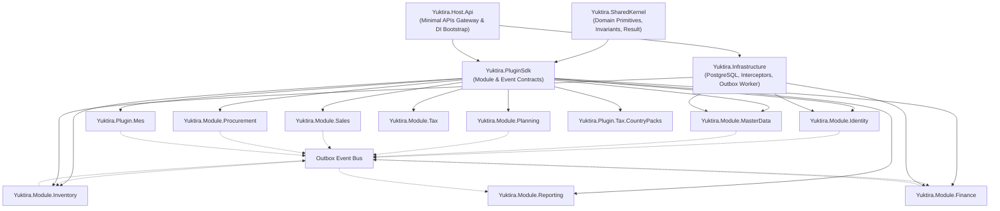
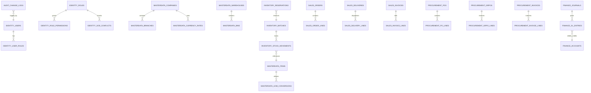
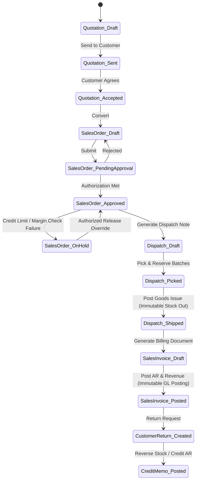
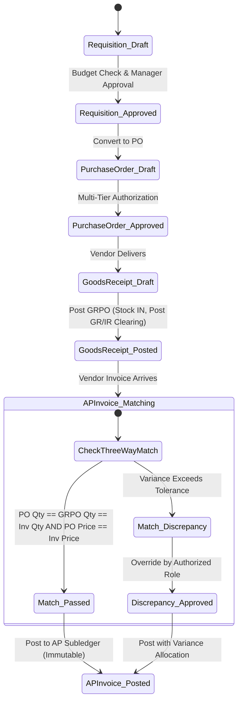
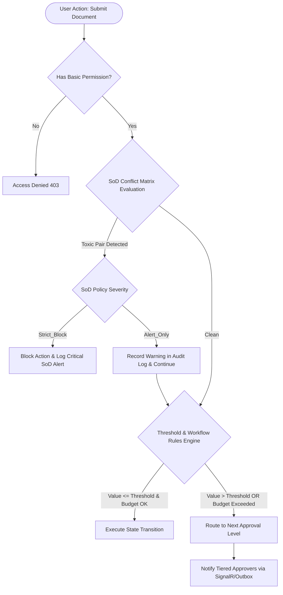

# PHASE 1: ENTERPRISE ARCHITECTURE BLUEPRINT & SAP GAP ANALYSIS
**Product:** YuktiraERP  
**Organization:** NR LABS  
**Motto:** *"Nothing happens without planning."*

---

## 1. Assumptions, Risks & Acceptance Criteria

### 1.1 Architectural Assumptions
1. **Target Runtime & Language**: .NET 10 LTS, C# 13/14, ASP.NET Core Minimal APIs for lightweight HTTP routing, Native AOT/ready-to-run friendliness, EF Core 10 for ORM.
2. **Database Engine**: PostgreSQL 16+ utilizing dedicated per-module schemas (`identity`, `masterdata`, `inventory`, `planning`, `sales`, `procurement`, `finance`, `mes`, `tax`, `audit`, `outbox`) in a single or distributed database instance.
3. **Write Isolation Invariant**: Zero cross-schema foreign keys or joins across bounded module contexts on the write path. Inter-module data reconciliation occurs strictly through domain events mediated by an transactional Outbox pattern and synchronous query contracts.
4. **Read Models & Analytical Queries**: Cross-module reporting is served via PostgreSQL materialized views, read-optimized projection tables, and read-only database replicas.
5. **Deployment & Operational Topology**: Local-first and self-hosted (Docker Compose, Kubernetes, Podman, or standalone Linux/Windows VMs). Zero mandatory cloud dependencies; fully operational in air-gapped manufacturing plants.
6. **Frontend Experience**: React 19 + TypeScript SPA with client-side draft persistence (`IndexedDB`), high-density dynamic data grids (virtualized scrolling, frozen columns, column show/hide), instant client-side Excel/CSV/PDF export, full i18n + RTL support, and keyboard-first SAP-style transaction code (`/n...`, `/o...`) navigation.

### 1.2 Enterprise Risks & Mitigation Strategies

| Risk | Impact | Architectural Mitigation Strategy |
| :--- | :--- | :--- |
| **Cross-Module Consistency** | High | Use the **Transactional Outbox Pattern** with PostgreSQL `SKIP LOCKED` worker queues to guarantee at-least-once delivery of inter-module integration events without distributed 2PC locks. |
| **Inventory Write Contention** | High | Stock movements (`inventory.stock_movements`) are append-only. Stock balances are derived from period rollups and optimistic concurrency tokens (`xmin`), preventing deadlock on high-velocity items. |
| **Audit Log Volume & Performance** | Medium | The `audit.change_logs` and `finance.general_ledger_entries` tables use **declarative range partitioning by period** (monthly/quarterly). Read queries route directly to the active partition. |
| **Segregation of Duties (SoD) Bypass** | Critical | Enforce dual-layer authorization: (1) Superadmin-configurable rule engine validating thresholds and approval matrices before state transition, and (2) SoD conflict matrix engine preventing conflicting role assignment and transaction execution. |
| **Document Mutation Invariants** | Critical | Posted documents (`Posted = true`) are strictly immutable. Domain entities reject update/delete mutations; corrections require auto-generated reversal documents linked via `document_flow`. |

### 1.3 Phase 1 Acceptance Criteria
- [x] Solution assembly layout and physical dependency graph defined with strict acyclic dependency rules.
- [x] PostgreSQL schemas, tables, primary keys, optimistic concurrency tokens, and period partitioning strategies fully specified.
- [x] End-to-end state machines and predecessor/successor document flow graphs detailed for O2C, P2P, Inventory, and Finance.
- [x] Pre-posting business invariants defined (double-entry zero-balance, period lock, available-to-promise, credit limits).
- [x] Authorization rule schema and SoD toxic matrix engine formalized.
- [x] `IYuktiraModule` plugin contract and assembly loader specification documented.
- [x] Comprehensive SAP Business One / S/4HANA Cloud gap analysis completed with clear `Cover` / `Partial` / `Deferred` mapping.

---

## 2. Solution Layout & Module Dependency Rules

### 2.1 Target Solution Structure
```
c:\my projects\yuktira3\
├── YuktiraERP\
│   ├── YuktiraERP.sln
│   ├── Directory.Build.props
│   └── src\
│       ├── Yuktira.SharedKernel\            # Pure primitives: Result<T>, Money, IAuditable, IEntity, OutboxMessage
│       ├── Yuktira.PluginSdk\               # IYuktiraModule, IEndpointModule, IDomainEventHandler, IEFConfigProvider
│       ├── modules\
│       │   ├── Yuktira.Module.Identity\     # RBAC, SoD Conflict Engine, User Management, Tokens
│       │   ├── Yuktira.Module.MasterData\   # Multi-company, Currency/FX, UOM, Warehouse/Bin, Business Partners
│       │   ├── Yuktira.Module.Inventory\    # Batches, Serial Nos, Stock Movements, FIFO/FEFO/MA Valuation, Bins
│       │   ├── Yuktira.Module.Planning\     # Multi-level BOM, Routings, Work Centers, MRP, MPS
│       │   ├── Yuktira.Module.Sales\        # O2C: Quotation, Order, Hold/Release, Dispatch, Invoicing, Returns
│       │   ├── Yuktira.Module.Procurement\  # P2P: Requisition, PO, GRPO, Service Entry, 3-Way Match AP Invoice
│       │   ├── Yuktira.Module.Finance\      # GL, AP/AR Subledgers, Cost Centers, Budgets, Assets, Close Checklist
│       │   ├── Yuktira.Module.Reporting\    # Materialized View Refreshers, Export Engine, OData/REST query adapters
│       │   └── Yuktira.Module.Tax\          # Country-agnostic tax engine, tax rate tables, tax determination rules
│       ├── plugins\
│       │   ├── Yuktira.Plugin.Mes\          # Production execution, MESA-11, machine telemetry, yield variance
│       │   └── Yuktira.Plugin.Tax.CountryPacks\ # Specific country adapters (e.g., GST, VAT, Peppol e-invoicing)
│       ├── Yuktira.Infrastructure\          # PostgreSQL DbContexts, Interceptors, Outbox Processor, Redis Cache
│       ├── Yuktira.Host.Api\                # ASP.NET Core Minimal APIs Host, Module Loader, Swagger/OpenAPI
│       ├── Yuktira.Tests\                   # Unit, Integration, Concurrency, and Invariant Verification Suite
│       └── web\                             # React 19 + TypeScript SPA (Vite, Tailwind, Virtual Grid, i18n)
```

### 2.2 Module Dependency Invariants (DAG)



#### Enforced Dependency Rules:
1. **No Lateral Direct References**: `Yuktira.Module.Sales` **must not** reference `Yuktira.Module.Finance` or `Yuktira.Module.Inventory`. Communication occurs strictly via:
   - Asynchronous domain events stored in the `outbox.messages` table.
   - Read-only queries against in-process mediated contracts (e.g., `IStockAvailabilityQueryService`).
2. **Persistence Isolation**: Each module declares its own EF Core `IEntityTypeConfiguration<T>` implementations. `Yuktira.Infrastructure` aggregates configurations dynamically per schema during `OnModelCreating`.
3. **No Distributed Transactions (2PC)**: Transactions are local to each module's schema. Multi-module operations are modeled as orchestrated Sagas with compensating actions.

---

## 3. PostgreSQL Schemas & Table Architecture

Each module is mapped to an isolated PostgreSQL schema. Tables utilize UUIDv7 or sequential identifiers, UTC timestamps, `xmin` optimistic concurrency tokens, and row-level multi-company isolation (`company_id`, `branch_id`).



### 3.1 Schema & Table Definitions

#### 1. Schema: `identity`
- `users`: `id (uuid PK)`, `company_id (uuid)`, `username (varchar)`, `email (varchar)`, `password_hash (text)`, `is_active (bool)`, `is_locked (bool)`, `failed_attempts (int)`, `created_at_utc (timestamptz)`.
- `roles`: `id (uuid PK)`, `company_id (uuid)`, `code (varchar 50)`, `name (varchar 100)`, `is_system (bool)`.
- `permissions`: `id (uuid PK)`, `module (varchar 50)`, `resource (varchar 50)`, `action (varchar 50)`, `description (text)`.
- `role_permissions`: `role_id (uuid)`, `permission_id (uuid)`, `granted_at_utc (timestamptz)`.
- `user_roles`: `user_id (uuid)`, `role_id (uuid)`, `branch_id (uuid null)`, `assigned_at_utc (timestamptz)`.
- `sod_rules`: `id (uuid PK)`, `rule_code (varchar 50)`, `first_role_id (uuid)`, `second_role_id (uuid)`, `severity (varchar 20)` (Strict_Block, Alert_Only), `description (text)`.
- `authorization_rules`: `id (uuid PK)`, `company_id (uuid)`, `document_type (varchar 50)`, `min_threshold (numeric 18,4)`, `max_threshold (numeric 18,4)`, `required_role_id (uuid)`, `require_budget_check (bool)`, `is_override_allowed (bool)`.

#### 2. Schema: `masterdata`
- `companies`: `id (uuid PK)`, `code (varchar 20)`, `legal_name (varchar 200)`, `base_currency_code (varchar 3)`, `is_active (bool)`.
- `branches`: `id (uuid PK)`, `company_id (uuid)`, `code (varchar 20)`, `name (varchar 100)`, `is_active (bool)`.
- `currencies`: `code (varchar 3 PK)`, `name (varchar 50)`, `symbol (varchar 10)`, `decimal_places (int)`.
- `currency_rates`: `id (uuid PK)`, `company_id (uuid)`, `from_currency (varchar 3)`, `to_currency (varchar 3)`, `rate_date (date)`, `spot_rate (numeric 18,6)`, `is_closing_rate (bool)`.
- `uoms`: `code (varchar 20 PK)`, `name (varchar 50)`, `uom_category (varchar 50)`.
- `uom_conversions`: `id (uuid PK)`, `item_id (uuid null)`, `from_uom (varchar 20)`, `to_uom (varchar 20)`, `conversion_factor (numeric 18,8)`.
- `items`: `id (uuid PK)`, `code (varchar 50 UNIQUE)`, `name (varchar 200)`, `item_type (varchar 20)` (Purchased, Manufactured, Service), `valuation_method (varchar 20)` (MovingAverage, Standard, FIFO), `base_uom (varchar 20)`, `inventory_uom (varchar 20)`, `standard_cost (numeric 18,4)`, `is_batch_tracked (bool)`, `is_serial_tracked (bool)`, `is_active (bool)`, `xmin (xid)`.
- `warehouses`: `id (uuid PK)`, `company_id (uuid)`, `branch_id (uuid)`, `code (varchar 20)`, `name (varchar 100)`, `is_bin_enabled (bool)`.
- `bins`: `id (uuid PK)`, `warehouse_id (uuid)`, `code (varchar 50)`, `aisle (varchar 10)`, `rack (varchar 10)`, `shelf (varchar 10)`, `bin_status (varchar 20)`.
- `business_partners`: `id (uuid PK)`, `company_id (uuid)`, `code (varchar 50 UNIQUE)`, `partner_name (varchar 200)`, `partner_type (varchar 20)` (Customer, Vendor, Both), `currency_code (varchar 3)`, `credit_limit (numeric 18,4)`, `payment_terms_code (varchar 20)`, `is_active (bool)`.
- `numbering_series`: `id (uuid PK)`, `company_id (uuid)`, `document_type (varchar 50)`, `prefix (varchar 10)`, `suffix (varchar 10)`, `next_number (bigint)`, `ending_number (bigint)`, `fiscal_year (int)`.

#### 3. Schema: `inventory`
- `batches`: `id (uuid PK)`, `item_id (uuid)`, `batch_number (varchar 100)`, `manufacturing_date (date null)`, `expiry_date (date null)`, `supplier_batch (varchar 100 null)`, `is_locked (bool)`, `created_at_utc (timestamptz)`.
- `serials`: `id (uuid PK)`, `item_id (uuid)`, `serial_number (varchar 100)`, `status (varchar 20)` (InStock, Dispatched, Quarantined, Scrapped).
- `stock_movements` *(PARTITIONED BY RANGE on `movement_date`)*:
  `id (bigserial)`, `movement_date (timestamptz)`, `company_id (uuid)`, `warehouse_id (uuid)`, `bin_id (uuid null)`, `item_id (uuid)`, `batch_id (uuid null)`, `serial_id (uuid null)`, `movement_type (varchar 50)` (GoodsReceipt, Dispatch, Transfer, Scrap, CountAdjustment), `quantity (numeric 18,4)`, `uom_code (varchar 20)`, `unit_cost (numeric 18,4)`, `total_value (numeric 18,4)`, `predecessor_doc_type (varchar 50)`, `predecessor_doc_id (uuid)`, `created_at_utc (timestamptz)`, `created_by_user_id (uuid)`.
- `inventory_valuations`: `item_id (uuid)`, `warehouse_id (uuid)`, `on_hand_qty (numeric 18,4)`, `total_value (numeric 18,4)`, `moving_avg_cost (numeric 18,4)`, `last_revalued_utc (timestamptz)`.
- `reservations`: `id (uuid PK)`, `order_line_id (uuid)`, `item_id (uuid)`, `batch_id (uuid null)`, `warehouse_id (uuid)`, `reserved_quantity (numeric 18,4)`, `status (varchar 20)` (Active, Consumed, Released), `expires_at_utc (timestamptz)`.

#### 4. Schema: `planning`
- `boms`: `id (uuid PK)`, `item_id (uuid)`, `bom_code (varchar 50)`, `version (int)`, `is_active (bool)`, `yield_percentage (numeric 5,2)`.
- `bom_lines`: `id (uuid PK)`, `bom_id (uuid)`, `component_item_id (uuid)`, `quantity (numeric 18,4)`, `scrap_percentage (numeric 5,2)`, `uom_code (varchar 20)`.
- `work_centers`: `id (uuid PK)`, `code (varchar 50)`, `name (varchar 100)`, `capacity_units_per_day (numeric 18,2)`, `cost_per_hour (numeric 18,4)`.
- `routings`: `id (uuid PK)`, `item_id (uuid)`, `routing_code (varchar 50)`, `version (int)`, `is_active (bool)`.
- `routing_operations`: `id (uuid PK)`, `routing_id (uuid)`, `operation_seq (int)`, `work_center_id (uuid)`, `setup_time_mins (numeric 18,2)`, `run_time_per_unit_mins (numeric 18,2)`.
- `planned_orders`: `id (uuid PK)`, `item_id (uuid)`, `quantity (numeric 18,4)`, `order_source (varchar 20)` (Forecast, SalesDemand, MinStock), `due_date (date)`, `status (varchar 20)` (Suggested, Confirmed, Converted).

#### 5. Schema: `sales` (Order-to-Cash)
- `sales_quotations` & `lines`: Draft -> Sent -> Accepted -> Expired -> Converted.
- `sales_orders`: `id (uuid PK)`, `company_id (uuid)`, `order_number (varchar 50 UNIQUE)`, `customer_id (uuid)`, `status (varchar 20)` (Draft, PendingApproval, Approved, OnHold, Released, PartiallyDispatched, Completed, Cancelled), `order_date (date)`, `currency_code (varchar 3)`, `subtotal (numeric 18,4)`, `tax_total (numeric 18,4)`, `grand_total (numeric 18,4)`, `hold_reason (text null)`, `xmin (xid)`.
- `sales_order_lines`: `id (uuid PK)`, `sales_order_id (uuid)`, `line_no (int)`, `item_id (uuid)`, `requested_qty (numeric 18,4)`, `dispatched_qty (numeric 18,4)`, `unit_price (numeric 18,4)`, `discount_percent (numeric 5,2)`, `line_total (numeric 18,4)`, `uom_code (varchar 20)`.
- `sales_deliveries`: `id (uuid PK)`, `delivery_number (varchar 50 UNIQUE)`, `sales_order_id (uuid)`, `status (varchar 20)` (Draft, Picked, Dispatched, Delivered, Returned), `dispatch_date (timestamptz)`, `carrier (varchar 100)`, `tracking_ref (varchar 100)`, `xmin (xid)`.
- `sales_invoices`: `id (uuid PK)`, `invoice_number (varchar 50 UNIQUE)`, `delivery_id (uuid null)`, `sales_order_id (uuid null)`, `status (varchar 20)` (Draft, Approved, Posted, Paid, PartiallyPaid, Reversed), `invoice_date (date)`, `due_date (date)`, `total_amount (numeric 18,4)`, `tax_amount (numeric 18,4)`, `balance_due (numeric 18,4)`, `reversal_invoice_id (uuid null)`.
- `sales_returns`: `id (uuid PK)`, `return_number (varchar 50)`, `invoice_id (uuid)`, `reason_code (varchar 50)`, `status (varchar 20)`.

#### 6. Schema: `procurement` (Procure-to-Pay)
- `purchase_requisitions`: Draft -> Submitted -> Approved -> ConvertedToPO -> Rejected.
- `purchase_orders`: `id (uuid PK)`, `po_number (varchar 50 UNIQUE)`, `vendor_id (uuid)`, `status (varchar 20)` (Draft, PendingApproval, Approved, Issued, PartiallyReceived, Completed, Cancelled), `order_date (date)`, `total_amount (numeric 18,4)`, `budget_cleared (bool)`, `xmin (xid)`.
- `purchase_order_lines`: `id (uuid PK)`, `purchase_order_id (uuid)`, `line_no (int)`, `item_id (uuid)`, `ordered_qty (numeric 18,4)`, `received_qty (numeric 18,4)`, `unit_cost (numeric 18,4)`, `line_total (numeric 18,4)`.
- `goods_receipt_pos`: `id (uuid PK)`, `grpo_number (varchar 50 UNIQUE)`, `purchase_order_id (uuid)`, `receipt_date (timestamptz)`, `status (varchar 20)` (Draft, Inspected, Posted, Returned), `xmin (xid)`.
- `service_entry_sheets`: `id (uuid PK)`, `ses_number (varchar 50)`, `purchase_order_id (uuid)`, `service_performed_by (varchar 100)`, `approved_amount (numeric 18,4)`, `status (varchar 20)`.
- `ap_invoices`: `id (uuid PK)`, `invoice_number (varchar 50 UNIQUE)`, `vendor_id (uuid)`, `po_id (uuid null)`, `grpo_id (uuid null)`, `status (varchar 20)` (Draft, UnderMatchReview, Matched, Posted, Paid, Disputed, Reversed), `three_way_match_status (varchar 20)` (ExactMatch, QuantityVariance, PriceVariance, PassedWithTolerance), `subtotal (numeric 18,4)`, `tax_total (numeric 18,4)`, `grand_total (numeric 18,4)`.

#### 7. Schema: `finance`
- `chart_of_accounts`: `id (uuid PK)`, `company_id (uuid)`, `account_code (varchar 50 UNIQUE)`, `account_name (varchar 200)`, `account_type (varchar 20)` (Asset, Liability, Equity, Revenue, Expense), `is_reconciliation (bool)`, `is_active (bool)`.
- `fiscal_periods`: `id (uuid PK)`, `company_id (uuid)`, `period_name (varchar 20)`, `start_date (date)`, `end_date (date)`, `is_closed (bool)`, `is_locked (bool)`.
- `cost_centers`: `id (uuid PK)`, `company_id (uuid)`, `code (varchar 50)`, `name (varchar 100)`.
- `budgets`: `id (uuid PK)`, `company_id (uuid)`, `cost_center_id (uuid)`, `fiscal_year (int)`, `allocated_amount (numeric 18,4)`, `consumed_amount (numeric 18,4)`.
- `general_ledger_entries` *(PARTITIONED BY RANGE on `posting_date`)*:
  `id (bigserial)`, `posting_date (date)`, `company_id (uuid)`, `journal_number (varchar 50)`, `account_id (uuid)`, `debit_amount (numeric 18,4)`, `credit_amount (numeric 18,4)`, `currency_code (varchar 3)`, `fx_rate (numeric 18,6)`, `base_debit (numeric 18,4)`, `base_credit (numeric 18,4)`, `cost_center_id (uuid null)`, `source_document_type (varchar 50)`, `source_document_id (uuid)`, `is_reversal (bool)`, `reversal_for_entry_id (bigint null)`, `created_at_utc (timestamptz)`, `posted_by_user_id (uuid)`.
- `fixed_assets`: `id (uuid PK)`, `asset_code (varchar 50)`, `asset_name (varchar 200)`, `asset_category (varchar 50)`, `acquisition_date (date)`, `acquisition_cost (numeric 18,4)`, `depreciation_method (varchar 20)` (StraightLine, ReducingBalance), `useful_life_months (int)`, `accumulated_depreciation (numeric 18,4)`, `is_cwip (bool)`.

#### 8. Schema: `audit` & `outbox`
- `audit.change_logs` *(PARTITIONED BY RANGE on `timestamp_utc`)*:
  `id (bigserial)`, `timestamp_utc (timestamptz)`, `entity_type (varchar 100)`, `entity_pk (varchar 100)`, `action (varchar 10)` (Insert, Update, Delete), `actor_user_id (uuid null)`, `ip_address (varchar 45)`, `changed_fields_json (jsonb)`. *(Credentials, tokens, and hashes are explicitly scrubbed by the interceptor).*
- `outbox.messages`:
  `id (uuid PK)`, `occurred_at_utc (timestamptz)`, `event_type (varchar 200)`, `aggregate_id (varchar 100)`, `payload_json (jsonb)`, `is_published (bool)`, `published_at_utc (timestamptz null)`, `retry_count (int)`, `last_error (text null)`.

---

## 4. Document State Machines, Invariants & Flow Engine

### 4.1 Order-to-Cash (O2C) Document Flow & State Machine



### 4.2 Procure-to-Pay (P2P) Document Flow & 3-Way Match



### 4.3 Pre-Posting Business Invariants
1. **General Ledger Balance Invariant**:
   $$\sum \text{BaseDebit} - \sum \text{BaseCredit} = 0.0000$$
   Enforced in the domain model before any `GeneralLedgerEntry` collection is committed.
2. **Fiscal Period Lock Invariant**:
   $$\text{FiscalPeriod.IsClosed} = \text{false} \quad \land \quad \text{FiscalPeriod.IsLocked} = \text{false}$$
   Posting into locked or closed periods is rejected by the transaction coordinator.
3. **Double-Posting Prevention**:
   Every document maintains an idempotent command token (`IdempotencyKey`). Duplicate submits within 24 hours return the existing transaction receipt without re-execution.
4. **Document Reversal Protocol**:
   Posted documents **cannot be modified or deleted via SQL or API**. Any correction creates a reversal document with opposite debit/credit signs, linking back to `ReversalForEntryId`.

---

## 5. Authorization, RBAC & Segregation-of-Duties (SoD) Engine

### 5.1 Architecture of the SoD & Authorization Engine

The authorization system operates in two distinct evaluation phases:
1. **Preventative Static SoD Check**: Evaluated during Role Assignment to prevent users from acquiring mutually exclusive roles.
2. **Dynamic Transaction Rule Check**: Evaluated at runtime against document values, budget balances, and transaction thresholds.



### 5.2 Toxic Combination (SoD) Conflict Matrix

| Rule Code | First Activity / Role | Conflicting Activity / Role | Severity | Risk Addressed |
| :--- | :--- | :--- | :--- | :--- |
| **SOD-001** | `VendorMaster_Maintain` | `APInvoice_Post` | **Strict_Block** | Creation of fictitious vendors and processing fraudulent payments. |
| **SOD-002** | `PO_Create` | `PO_Approve` | **Strict_Block** | Self-authorizing unvetted purchases (maker-checker invariant). |
| **SOD-003** | `GoodsReceipt_Post` | `APInvoice_Post` | **Strict_Block** | Fictitious inventory receipt followed by invoice authorization. |
| **SOD-004** | `BankReconciliation_Perform` | `Disbursement_Create` | **Strict_Block** | Concealment of unauthorized bank payments. |
| **SOD-005** | `CreditLimit_Override` | `SalesOrder_Create` | **Alert_Only** | Bypassing credit policy to inflate sales orders. |
| **SOD-006** | `InventoryCount_Conduct` | `InventoryAdjustment_Post` | **Strict_Block** | Concealing physical stock theft via ledger adjustment. |

### 5.3 Configurable Authorization Rule Schema (JSON/Dynamic DSL)
Authorization rules are managed by superadmins without code deployment:
```json
{
  "ruleId": "PO-AUTH-TIER-02",
  "documentType": "PurchaseOrder",
  "companyId": "018f3a2b-7c89-7000-8000-000000000001",
  "conditions": [
    { "field": "TotalAmount", "operator": "GreaterThan", "value": 50000.00 },
    { "field": "DepartmentBudgetExceeded", "operator": "Equals", "value": true }
  ],
  "requiredApprovalRoles": [
    "Role_VP_Finance",
    "Role_Chief_Procurement_Officer"
  ],
  "escalationHours": 48,
  "allowSelfApproval": false
}
```

---

## 6. Plugin Architecture & Module Contract (`IYuktiraModule`)

The system follows a pure Modular Monolith pattern. The core host discovers and registers modules and country packs dynamically at startup via assembly scanning and manifest verification.

### 6.1 `IYuktiraModule` Core Contract Definition
```csharp
namespace Yuktira.PluginSdk;

public interface IYuktiraModule
{
    string Id { get; }
    string Name { get; }
    string Version { get; }
    int Priority { get; } // Boot order
    IReadOnlyList<string> Dependencies { get; }

    void RegisterServices(IServiceCollection services, IConfiguration configuration);
    void ConfigureEndpoints(IEndpointRouteBuilder endpoints);
    void ConfigureModel(ModelBuilder modelBuilder);
    void RegisterEventSubscriptions(IEventBusRegistry registry);
    IReadOnlyList<NavigationRouteDescriptor> GetNavigationRoutes();
}
```

### 6.2 Assembly Registration & Sandboxing
- Modules register Minimal API endpoint groups under their respective route prefixes (e.g., `/api/v1/inventory/*`).
- Dynamic EF Core configuration is injected via:
  ```csharp
  public void ConfigureModel(ModelBuilder modelBuilder)
  {
      modelBuilder.HasDefaultSchema("inventory");
      modelBuilder.ApplyConfigurationsFromAssembly(typeof(InventoryModule).Assembly);
  }
  ```
- Cross-module event handlers subscribe to domain events without direct project dependencies:
  ```csharp
  registry.Subscribe<GoodsReceiptPostedEvent, UpdateInventoryValuationHandler>();
  registry.Subscribe<SalesInvoicePostedEvent, PostGeneralLedgerHandler>();
  ```

---

## 7. YuktiraERP vs SAP Business One / S/4HANA Public Edition Gap Analysis

| Process / Area | SAP Business One / S4 Cloud Equivalent | YuktiraERP Status | YuktiraERP Competitive Advantage / Differentiator |
| :--- | :--- | :--- | :--- |
| **Deployment & Footprint** | Cloud-only (S/4) or Heavy Windows/MSSQL/HANA (B1) | **Cover** | **Zero-cloud dependency, local-first Docker/Linux/Windows support.** Deploys in minutes on commodity hardware. |
| **Speed of Configuration** | Heavy consulting required; IMG/SPRO configurations | **Cover** | **No-Code Rule Engine**. Superadmins configure numbering series, approval matrices, and SoD rules via web UI in hours. |
| **Multi-Company & Branch** | Available (requires B1 Intercompany add-on) | **Cover** | **Native multi-company, multi-branch, and multi-currency consolidation** built directly into the core with zero license surcharge. |
| **Batch & Serial Inventory** | Standard in B1, complex in S/4 | **Cover** | **Zero-quantity batch auto-hiding, per-batch costing clarity, and FEFO expiry tracking** built natively into picker screens. |
| **MES & Shop Floor Execution** | Not native; requires Boyum Beas or SAP ME | **Cover** | **Native MESA-11 MES plugin (`Yuktira.Mes`)**: live machine telemetry ingestion, edge gateway, yield variance, and work center dispatch. |
| **Document Flow Traceability** | Relationship Map | **Cover** | **Interactive WebGL/SVG Document Flow Graph** linking requisition $\to$ PO $\to$ GRPO $\to$ AP Invoice $\to$ GL Journal with drill-down. |
| **3-Way Matching Engine** | Standard B1/S4 AP matching | **Cover** | **Automated 3-way matching** with configurable price/quantity tolerance bands and automatic line variance distribution. |
| **Period-End Close** | Complex transaction locking (OB52/MMPV) | **Cover** | **Interactive Period-End Checklist** with automated pre-flight balance checks, open document warnings, and one-click soft/hard locks. |
| **Country Localization & Tax** | Localized core versions (60+ country databases) | **Cover** | **Clean Country-Pack Plugin Architecture**. Zero country-specific tax rules in core; delivered as pluggable adapters. |
| **Dynamic Data Grids** | SAP GUI ALV Grid / Fiori Smart Table | **Cover** | **High-density React virtualized grid** with keyboard-first entry, client-side draft persistence, and instant client-side Excel/PDF streaming. |
| **Fixed Assets & CWIP** | Add-on or S4 Fixed Assets | **Cover** | Built-in asset lifecycle, straight-line/reducing-balance depreciation schedules, and Capital Work-in-Progress (CWIP) capitalization. |
| **MRP & Capacity Planning** | MRP Wizard / S4 Production Planning | **Cover** | **Multi-level BOM explosion, finite work center capacity scheduling, and automated planned order generation**. |
| **Advanced Warehouse (EWM)** | SAP EWM (High license tier) | **Partial** | Covers bin management, wave picking, and velocity slotting. Complex autonomous robotic vehicle orchestration is deferred to WCS plugins. |
| **HR & Payroll** | SAP SuccessFactors / Core HR | **Partial** | Provides employee master data, cost allocation to cost centers, and departmental approvals. Full regional gross-to-net payroll deferred to country plugins. |
| **CRM Pipeline & Marketing** | SAP Sales Cloud / B1 CRM | **Partial** | Core covers quotation-to-cash, customer master, and credit terms. Omnichannel marketing campaigns deferred to external CRM webhooks. |
| **Plant Maintenance (EAM)** | SAP PM (Plant Maintenance) | **Partial** | Machine downtime tracking and preventive maintenance scheduling integrated in MES; advanced predictive ML maintenance is deferred. |
| **Project Systems (PS)** | SAP Project System | **Deferred** | Pluggable architecture ready; milestone billing and WBS project accounting planned for external module plugin. |
| **Treasury & Risk Management** | SAP Treasury Management | **Deferred** | Foreign exchange revaluation and bank reconciliation covered; complex derivative hedging deferred. |

---

## 8. Summary & Next Steps

This blueprint establishes:
1. **Architectural Purity**: Clean modular monolith boundaries, schema-per-module isolation, and transactional outbox event mediation.
2. **Enterprise Governance**: Auditing with field-level diffs, non-negotiable double-entry balancing, period-locking invariants, and immutable posted documents.
3. **Decisive Market Advantages**: Rapid self-hosted deployment, native MES shop-floor execution, built-in SoD conflict prevention, and dynamic client-side performance that outclasses legacy SAP B1 and S/4HANA Cloud Public Edition installations.
